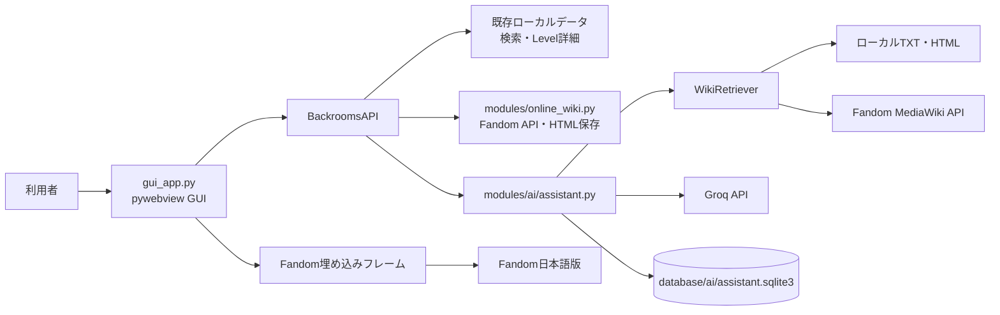
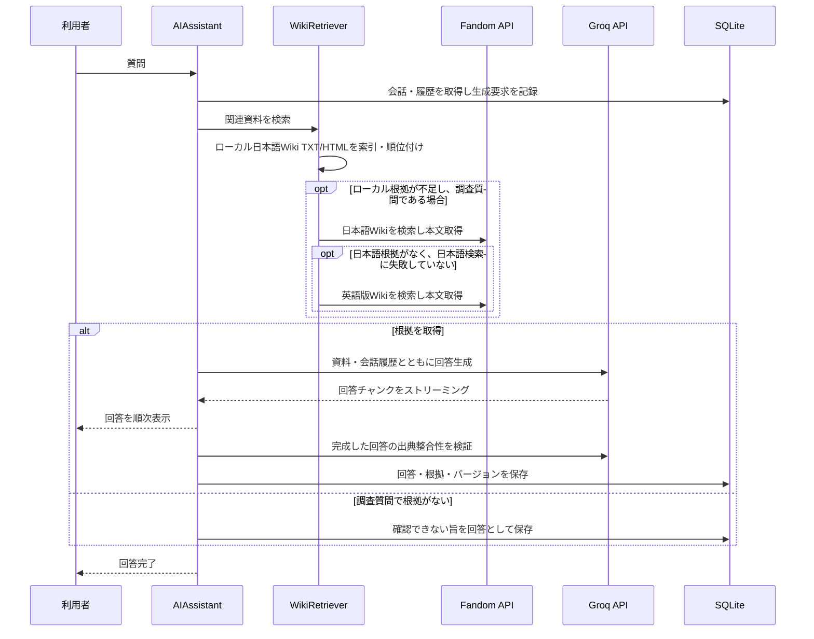
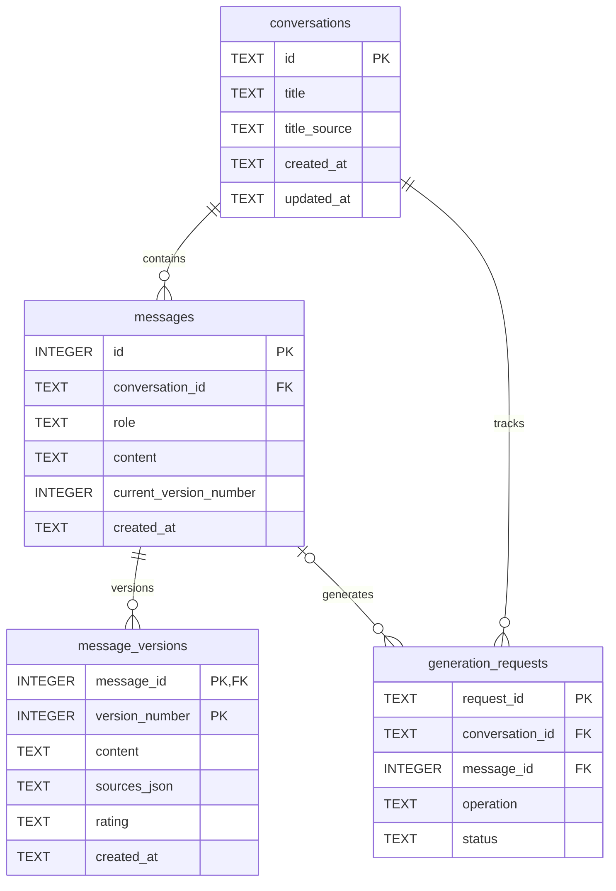

# BrNavi Fandom JP

Backrooms日本語版Fandom Wikiを閲覧するためのPython製デスクトップアプリです。ローカルWikiデータを使ったLevel検索・閲覧、Fandomの埋め込み閲覧・保存、Groq APIを使った出典付きAIチャットを提供します。

> **開発状況:** GUI版の実行ファイル（exe）はリリース配布していません。GUIはPythonソースから起動します。現在の `build_release.bat` がビルドするのはコンソール版です。

## 目次

- [機能](#機能)
- [ダウンロードと起動方法](#ダウンロードと起動方法)
- [システム構成](#システム構成)
- [Wiki閲覧とローカル保存の設計](#wiki閲覧とローカル保存の設計)
- [AI Assistantの検索・回答設計](#ai-assistantの検索回答設計)
- [会話データベースの設計](#会話データベースの設計)
- [データフォルダー](#データフォルダー)
- [テストと開発](#テストと開発)
- [制約とトラブルシューティング](#制約とトラブルシューティング)
- [ライセンスとコンテンツ利用](#ライセンスとコンテンツ利用)

## 機能

### Level図鑑・検索

- ローカルの抽出済みWiki本文からLevelを検索・閲覧します。
- Level番号は完全一致で検索します。検索対象の基本は本文ファイル名で、カテゴリ・言語などの補助情報はMaster Databaseから取得します。
- Levelの分類、危険度、理解度、画像などを表示します。
- 既存のローカルHTMLやFandomページを開く機能があります。

対象のWikiデータがローカルにない場合、このタブで検索結果、本文、画像を十分に表示できません。

### Wiki閲覧・保存

- Wikiタブ内にFandom日本語版を埋め込みます。最初にタブを開くと[Backrooms Wiki](https://backrooms.fandom.com/ja/wiki/Backrooms_Wiki)を表示します。
- ページ内リンクをたどって自由に閲覧できます。URL欄から記事URLを入力して移動することもできます。
- Fandom検索と検索結果のカテゴリタグによる絞り込みに対応します。
- 「表示中を保存」は表示中の記事HTMLを保存し、取得可能な画像を記事ごとのアセットフォルダーへ保存します。
- Wiki検索・閲覧・保存はMaster Databaseを必要としません。

保存できるURLは `https://backrooms.fandom.com/ja/wiki/` 配下の記事です。保存HTMLはオフライン閲覧用であり、Fandomページ全体（広告、ログイン状態、動的コンテンツ、スクリプト等）の完全な複製を保証しません。ダウンロードの詳細ログはCLIに出力し、GUIには保存状況を表示します。

### データ保守

保守タブには既存のローカルデータ機能があります。

| 操作 | 役割 |
| --- | --- |
| 既存データベース更新 | Master Databaseを更新 |
| 情報データベース更新 | 保存済みHTMLから本文・タグなどを抽出 |
| ネットワーク更新 | 抽出済みデータからLevel間の接続情報を生成 |

GUIはタスクの開始・完了・失敗を表示し、詳細な処理ログはCLI側へ出力します。これらのローカル処理はWikiタブのオンライン閲覧・保存には不要です。

### BrNavi AI Assistant

- Groq APIを利用する日本語Markdownチャットです。
- Markdownの見出し・リスト・引用・表・コード表示に対応します。コードブロックはPygmentsでハイライトし、表は横スクロールできます。表示前にHTMLをサニタイズします。
- 回答のコピー、Good / Bad評価、再生成、回答バージョンの前後切り替えに対応します。再生成では以前の回答を削除せず、生成に失敗した場合も以前の回答を維持します。
- 生成はストリーミング表示し、生成中は停止できます。会話の新規作成・名称変更・削除、会話タイトルの自動生成にも対応します。手動設定した会話名は自動生成で上書きしません。

AIを使用するには `GROQ_API_KEY` 環境変数が必要です。APIキーが未設定または無効の場合、AI機能は利用できません。

## ダウンロードと起動方法

### GUIアプリ（Windows）

現時点でGUI版exeは配布していません。[リポジトリのソースZIP](https://github.com/Suigetsu-Lium/BrNavi-FandomJP-GUI/archive/refs/heads/main.zip)をダウンロードして展開し、Python 3.10以降をインストールしてください。展開したフォルダーでPowerShellを開き、以下を実行します。

```powershell
python -m venv .venv
.\.venv\Scripts\Activate.ps1
python -m pip install -r requirements.txt
python gui_app.py
```

Windows GUIはMicrosoft Edge WebView2 Runtimeを使用します。Chromiumをアプリに同梱する方式ではありません。Runtimeがない場合は[Microsoft Edge WebView2 Runtime](https://developer.microsoft.com/microsoft-edge/webview2/)をインストールしてください。

AI Assistantを使用する場合は、同じPowerShellセッションでAPIキーを設定してから起動します。

```powershell
$env:GROQ_API_KEY = "your-groq-api-key"
python gui_app.py
```

APIキーをソースコードやREADMEに記載したり、公開リポジトリへ登録したりしないでください。

### コンソールアプリ

従来の対話型コンソールアプリは次のコマンドで起動します。

```powershell
python BackroomsNavigationSystem_FandomJP.py
```

Level検索・情報表示・ルート検索・ローカルデータ閲覧、HTML・画像ダウンロード、データベース更新を行います。コンソール版HTMLダウンロードはMaster Databaseを使う従来方式であり、GUIのオンラインWikiタブとは別の機能です。

### 配布用ビルド

`build_release.bat` はPyInstallerで `BackroomsNavigationSystem_FandomJP.py` をビルドします。現在のスクリプトは `gui_app.py` 用exeをビルドしません。ビルド時に存在する `parsed_index`、`level_lists`、`index_html` は配布フォルダーへコピーされます。

## システム構成

### コンポーネント

| ファイル / モジュール | 責務 |
| --- | --- |
| `gui_app.py` | GUIのHTML/CSS/JavaScript、pywebview APIブリッジ、Level検索、保守タスクの起動 |
| `modules/online_wiki.py` | Fandom MediaWiki API検索、ページ本文取得、URL検証、画像付きHTML保存 |
| `modules/ai/assistant.py` | AIチャットのオーケストレーション、検索資料の組み立て、回答検証、タイトル生成 |
| `modules/ai/wiki_retriever.py` | ローカルWiki資料の索引・順位付け、日本語版優先のオンライン検索 |
| `modules/ai/groq_client.py` | Groq Chat Completionsとストリーミング通信 |
| `modules/ai/markdown_renderer.py` | Markdown変換、Pygmentsコードハイライト、HTMLサニタイズ |
| `modules/ai/conversation.py` | SQLiteスキーマ、会話・メッセージ・回答バージョンの永続化 |
| `modules/database.py` | 既存Master Database、LevelデータやローカルHTMLへのアクセス |
| `modules/downloader.py` | 従来のMaster DBベースのHTMLダウンロードとURLダウンロード |
| `modules/extractor.py` | 保存済みHTMLから本文・タグなどを抽出 |
| `modules/network.py` / `modules/navigator.py` | 抽出データから接続ネットワークを生成し、経路を検索 |
| `BackroomsNavigationSystem_FandomJP.py` | 従来のコンソール版エントリーポイント |

### GUIとデータ経路



Windowsでは `webview.start(gui="edgechromium")` を使い、WebView2をレンダラーとして起動します。GUIの主画面は `HTML_TEMPLATE` から生成され、JavaScriptは `BackroomsAPI` のメソッドを `pywebview.api` 経由で呼び出します。

## Wiki閲覧とローカル保存の設計

1. Wikiタブの検索はFandomのMediaWiki API (`/ja/api.php`) を呼び出し、ページ名・URL・カテゴリを取得します。検索結果は最大30件です。
2. 選択した検索結果または入力されたURLは、日本語版WikiのHTTPS記事URLであることをPython側でも検証します。
3. 記事はWebView内のiframeへ読み込みます。WebViewのFandom HTML応答URLを監視して現在の記事URLを画面へ返し、「表示中を保存」の対象にします。
4. 保存処理は既存の `modules.downloader.download_url` を再利用してHTMLを取得し、`downloaded_fandom_html/` に保存します。
5. HTML内の許可されたFandom画像ホストを調べて画像を取得し、記事名に対応する `_assets` フォルダーへ相対パスで保存します。1ページあたり最大40画像、1画像あたり20 MiBまでです。

この方式は、閲覧ではFandom本来のページ表示を保ち、保存では既存ダウンローダーとの互換性を保つ設計です。画面に描画されたiframeのDOMをそのまま保存するものではありません。Fandomのページ構造・レスポンスヘッダー・画像ホストの変更により表示や保存が影響を受けることがあります。

## AI Assistantの検索・回答設計

### 検索と回答の流れ



- ローカル資料は `extracted_fandom_levels/` のTXTと `downloaded_fandom_html/` のHTMLから索引され、ファイル名、本文、Master Databaseのメタデータを使って順位付けされます。ローカル索引の対象は各形式最大5,000ファイルです。
- 通常は日本語Wikiの資料を優先します。日本語の根拠が見つからない調査質問では日本語版をオンライン検索して本文を取得し、それでも該当本文を確認できない場合に英語版を探索します。比較を明示した質問は外部資料も検索対象にします。
- 検索候補のタイトルやスニペットだけでは回答根拠にせず、ページ本文を取得できた資料を回答に渡します。資料がない調査質問には、情報を補完せず未確認である旨を返します。
- 根拠がある回答は別のGroq呼び出しで出典との整合性を検証し、回答に出典名・URL・取得時刻またはローカル更新時刻・抜粋を付けます。オンライン検索や本文取得の失敗も注意として示します。
- ストリーミングはGroq SDKの非同期ストリームを使います。停止操作は生成タスクをキャンセルし、完了・保存時にもキャンセル状態を確認します。再生成は完成した場合のみ新バージョンを保存するため、失敗・キャンセル時に既存回答は置き換わりません。

### 既定値と設定

| 設定 | 既定値 | 設定範囲 / 備考 |
| --- | --- | --- |
| Provider | Groq | `GROQ_API_KEY` が必要 |
| Model | `openai/gpt-oss-120b` | LLMプロパティから変更可能 |
| 最大出力トークン | 4,096 | 256～16,384 |
| 会話履歴 | 16メッセージ | 2～40 |
| コンテキスト文字数予算 | 26,000文字 | 内部既定値 |
| ローカル索引 | TXT/HTML各最大5,000件 | 資料量により検索時間が変わります |

出力上限で回答が終わった場合は続きを要求し、利用可能なコンテキストを超える場合は履歴や資料量を削減して再試行します。APIのモデル上限・レート制限・通信状態により、回答が失敗または短くなる場合があります。

## 会話データベースの設計

SQLiteファイルは `database/ai/assistant.sqlite3` です。主なテーブルと関係は次のとおりです。



- 回答バージョンの番号はメッセージごとに採番し、`message_versions` の複合主キー `(message_id, version_number)` が一意性を保証します。`messages.current_version_number` が表示中の版を指します。
- Good / Bad評価と出典スナップショットは回答バージョン単位で保存します。旧回答の評価や出典は再生成後も各バージョンに残ります。
- `generation_requests` は送信・再生成の状態（実行中、停止要求、完了、失敗、停止）を記録します。部分インデックスにより、1会話につき同時に1件の生成要求だけを実行できます。
- 会話の `title_source` は自動生成・手動設定・旧データを区別します。自動タイトル更新は `title_source='auto'` の会話に限ります。
- 外部キーは各SQLite接続で `PRAGMA foreign_keys = ON` を設定・確認します。会話削除では外部キーの `ON DELETE CASCADE` によりメッセージ、回答バージョン、生成要求を連鎖削除します。
- 現行スキーマ番号は `PRAGMA user_version = 1` です。既存DBを更新する場合は、SQLite Backup APIでタイムスタンプ付きバックアップを作成し、バックアップの `integrity_check` 後にトランザクション内で移行します。既存会話の回答は第1版として登録します。
- SQLite接続でWALモードは明示的に設定していません。SQLiteの既定ジャーナル設定を使用します。

## データフォルダー

| パス | 用途 |
| --- | --- |
| `parsed_index/` | Master Database等のインデックス。図鑑のメタデータ、旧ダウンロード、AI資料情報に利用 |
| `downloaded_fandom_html/` | 保存したWiki HTMLと画像アセット。AI検索もローカルHTMLを参照 |
| `extracted_fandom_levels/` | HTMLから抽出したLevel本文TXT。図鑑・AI検索に利用 |
| `downloaded_images/` | Level図鑑用画像 |
| `database/ai/` | SQLite会話DB、マイグレーションバックアップ、AI設定JSON |
| `level_lists/`, `index_html/` | コンソール版の既存データ／配布用ビルドで扱うデータ |

Wikiのオンライン閲覧・保存以外の機能は、対応するローカルデータが必要です。データは常にリポジトリや配布物へ同梱されるとは限りません。

## テストと開発

依存パッケージは `requirements.txt` に記載しています。テストには外部APIをモックするケースと、ローカルで動作するケースがあります。

```powershell
python -m unittest discover -s tests -v
```

主なテスト対象：

- `tests/test_gui_html_download.py`：GUI APIブリッジ、URL検証、埋め込みURL追跡、保守タスク状態通知
- `tests/test_online_wiki.py`：Fandom検索・本文サニタイズ・画像ローカル保存
- `tests/test_ai_wiki_retriever.py`：ローカル資料検索、出典優先順位、オンラインフォールバック
- `tests/test_ai_conversation.py`：SQLiteスキーマ、会話・回答バージョン、評価、削除、マイグレーション
- `tests/test_ai_groq_client.py`, `tests/test_ai_assistant.py`, `tests/test_ai_markdown_renderer.py`, `tests/test_ai_gui_bridge.py`：Groq通信、回答生成、Markdown表示、GUI連携

`build_release.bat` はコンソール版のみをビルドします。GUI版exeを配布する場合は、GUIエントリーポイント、WebView2実行環境、データ配置を含めた別のビルド設定が必要です。

## 制約とトラブルシューティング

- **GUIのWebViewが起動しない:** WindowsにWebView2 Runtimeがインストールされているか確認してください。
- **Wikiが表示されない:** インターネット接続とFandomの応答を確認してください。埋め込み表示はFandom側のiframe/CSP方針にも依存します。
- **Wiki保存で画像が不足する:** Fandomの画像URL・Content-Type・サイズ制限に合わない画像は保存されません。保存ログをCLIで確認してください。
- **AIが利用できない:** 起動したPowerShellの環境に `GROQ_API_KEY` が設定されているか、Groq APIキーとアカウント状態を確認してください。
- **AIの回答が未確認を返す:** ローカル資料が不足している、オンライン検索に失敗した、または質問とページ本文が合致しない可能性があります。検索状態と回答の出典欄を確認してください。
- **Level図鑑にデータがない:** `extracted_fandom_levels/`、必要に応じて `downloaded_images/` と `parsed_index/` があるか確認してください。Wikiタブの利用にはこれらは不要です。
- **依存パッケージが見つからない:** GUI起動に使うPython環境を有効化してから `python -m pip install -r requirements.txt` を実行してください。PyInstaller版は依存をインストールした環境で再ビルドが必要です。

## ライセンスとコンテンツ利用

ソフトウェア本体はMIT Licenseです（[`LICENSE`](LICENSE)を参照）。Fandom上の記事・画像等の著作物はこのソフトウェアのライセンス対象ではありません。保存データの利用・再配布にあたっては、各作品・ページのライセンス、Fandomの利用規約、および権利者の条件を確認してください。本ソフトウェアはBackrooms Fandom JP公式とは関係ありません。
