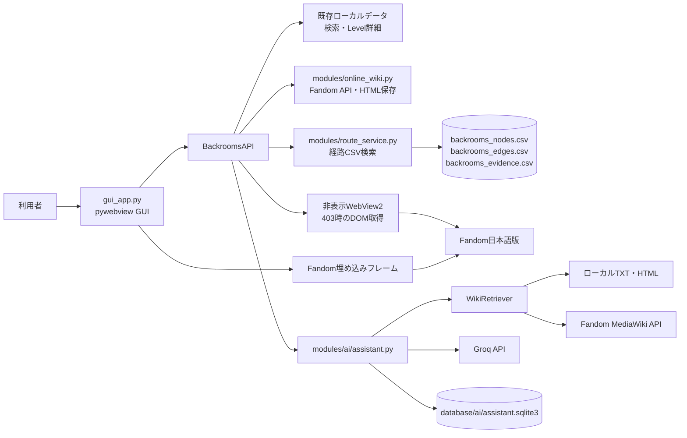
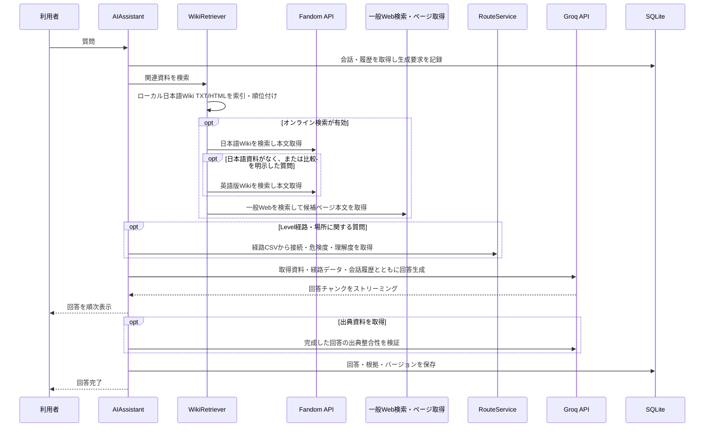
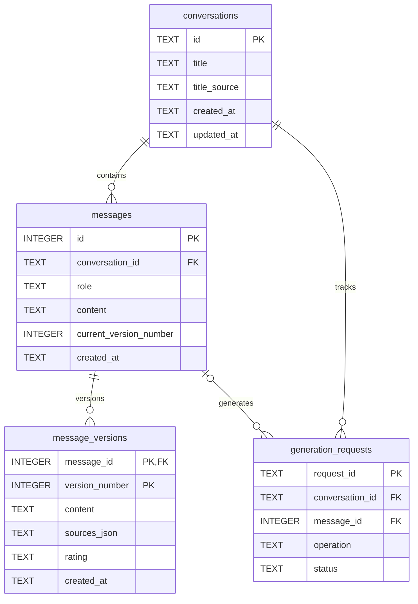

# アーキテクチャと開発ガイド

この文書はBrNavi Fandom JPの内部構成、データフロー、永続化方式、および開発時の方針を説明します。利用者向けの機能・導入手順は[README.md](../README.md)を参照してください。

## システム構成

### コンポーネント

| ファイル / モジュール | 責務 |
| --- | --- |
| `gui_app.py` | GUIのHTML/CSS/JavaScript、pywebview APIブリッジ、Level検索、経路フロー、レベルリストHTML取得、保守タスクの起動 |
| `modules/runtime_paths.py` | ソース実行時と凍結実行ファイル実行時のアプリケーションデータルート解決 |
| `modules/version.py` | GUI/CLI/ビルド処理で共用する `VERSION` 定数 |
| `modules/online_wiki.py` | Fandom MediaWiki API検索、ページ本文取得、URL検証、画像付きHTML保存 |
| `modules/ai/assistant.py` | AIチャットのオーケストレーション、検索資料の組み立て、回答検証、タイトル生成 |
| `modules/ai/wiki_retriever.py` | ローカルWiki資料の索引・順位付け、日本語・英語Backrooms Wikiおよび一般Webのオンライン検索と本文取得 |
| `modules/route_service.py` | 経路CSVの読み込み、非対話の候補解決・最短経路検索、AI向け経路コンテキスト |
| `modules/app_settings.py` | 一般設定の保存、暦上1か月単位の一覧データ自動更新スケジュール |
| `modules/system_dashboard.py` | ローカル時計表示、ネットワーク・電源状態、記憶域使用量、画像ギャラリー用ファイル一覧の副作用を抑えた計算 |
| `modules/data_cleanup.py` | 固定ホワイトリストに基づく保存済み生成データのプレビュー、パス安全性検証、計画再検証付き削除 |
| `modules/term_articles.py` | 保存済み用語記事HTMLのDOM抽出、許可要素・属性によるサニタイズ、用語専用本文HTMLの生成 |
| `modules/ai/groq_client.py` | Groq Chat Completionsとストリーミング通信 |
| `modules/ai/markdown_renderer.py` | Markdown変換、Pygmentsコードハイライト、HTMLサニタイズ |
| `modules/ai/conversation.py` | SQLiteスキーマ、会話・メッセージ・回答バージョンの永続化 |
| `modules/database.py` | 既存Master Database、LevelデータやローカルHTMLへのアクセス |
| `modules/downloader.py` | Master DBベースのHTMLダウンロードとURLダウンロード。保存は同一ディレクトリの一時ファイルから置換 |
| `modules/extractor.py` | 保存済みHTMLから本文・タグなどを抽出 |
| `modules/network.py` / `modules/navigator.py` | 保存HTMLから接続CSVを生成し、経路を検索 |
| `modules/operation_context.py` / `modules/operations.py` | GUI・CLIから利用する保守操作の実行文脈、ログ・進捗・協調キャンセル、サービス入口 |
| `BackroomsNavigationSystem_FandomJP.py` | 従来のコンソール版エントリーポイント |

### GUIとデータ経路

図鑑は日本語版Wiki「階層の一覧」の構成に合わせたハブ型表示です。初期画面には「階層の一覧」「無印通常階層」「通常階層 η」「番外階層」「亜階層」「別名」「用語」「翻訳」「コンテスト」の固定9タイルを表示し、言語支部別タイルは追加しません。「階層の一覧」は `hierarchy.html` の実際の見出し階層・掲載順から目次ハブを再構成し、専用一覧がある区分から対応する基本一覧へ誘導します。国際支部はEN / JP / RU / PL / IT / PT / UA / TR / ZHの9言語を扱い、Wiki見出しAは内部言語RUへ対応させます。RU / PL / IT / PT / UA / TR / ZHの支部別カテゴリ入口はHTML取得・データ抽出タブに動的生成し、図鑑トップには展開しません。基本一覧は一覧所属・見出し階層・言語情報から分類し、国際支部の記事が無印通常階層等へ混入しないようにします。Levelリンクは図鑑詳細へ進み、保存状態を表示します。左ペインはMaster Database、一覧データ、抽出Summaryを統合した予測検索を提供し、記事名・副題・別名・カテゴリで絞り込みます。候補はマウスまたは上下キー・Enterで選択し、空欄時は最近の閲覧履歴を表示します。未保存項目は内蔵Wikiの閲覧・保存フローへ接続します。

### 表示・端末情報・画像ビュー

テーマ (`light` / `dark`) とタイムゾーンは `database/app_settings.json` に保存します。ダークテーマはbody属性でCSS変数と既存のTailwind色クラスを上書きし、アプリ内の各タブとモーダルへ適用します。時計はフロントエンドで毎秒更新し、選択タイムゾーンで表示します。BRTはUTCと同じ時刻変換を使い、表示略称だけ `BRT` にします。ネットワーク種別と電源状態は `BackroomsAPI.get_system_status()` から取得し、7秒ごとに更新します。ネットワーク検出に失敗した場合はオフライン、電源状態を取得できない場合はAC給電表示へフォールバックします。

記憶域モニターは `modules/system_dashboard.py` が保存済みHTML、画像、抽出テキスト、DB、索引、ルート直下CSVを列挙して件数とバイト数を集計します。ドライブ使用量は標準ライブラリの `shutil.disk_usage` を使います。画像ギャラリーも同モジュールが `downloaded_images/` を走査し、ファイル名からLevel名を推定します。画像の新命名方式は保存HTMLの元ページURLのSHA-256短縮値と画像順を使い、同名の別記事を区別します。旧形式の画像は保存HTMLのURL・画像順・旧ファイル名を照合し、一意に対応する場合だけ移行プレビューに表示します。移行実行は既存ファイルを上書きせず、曖昧な対応や衝突はスキップします。画像メタデータを一覧で取得し、表示領域に入った画像または拡大表示された画像だけをAPI経由でdata URIとして読み込むため、起動時に全画像を一括転送しません。共通ライトボックスから拡大・前後移動・Level記事への逆引きを行い、記事内画像も同じモーダルと矢印キー操作を共有します。

経路タブ、CLI、AIは `modules/route_service.py` のCSV読込・候補解決を共有します。GUIは曖昧なLevel名に候補を返し、利用者が選択して再検索します。経路は有向グラフ上の最短経路を最大8件、最大深度30で返します。GUIは一覧から個別の縦型タイムラインへ進み、移動条件を大きく表示します。各Levelを図鑑で開き、本文が未保存なら内蔵Wikiへ案内します。環境設定からの接続CSV生成は `downloaded_fandom_html/` 内のLevel記事HTMLを直接解析し、正規スキーマの `backrooms_nodes.csv`、`backrooms_edges.csv`、`backrooms_evidence.csv` を検証付きで出力します。危険度・理解度はHTML本文から抽出し、不足する値を `extracted_fandom_levels_summary.csv` からLevelコードまたはメタタイトルで補完します。危険度の数値、可変、条件付き、N/Aと補足文を保持し、図鑑・経路詳細で同じ色区分を使います。LevelタイトルをHTMLページ情報から解決するため、記事本文を一つのTXTへ統合する処理に依存しません。解析できるLevelまたは接続が0件の場合は失敗として既存CSVを維持します。

AIは経路・出口・移動などの相談で、Levelが一つ指定された場合は登録された直接接続先、二つ指定された場合は両者間の最短経路候補をコンテキストに追加します。質問文に接続CSVの条件文が含まれる場合は、その条件と一致する経路レコードも優先して渡します。これらはローカルCSV出典として回答に付記します。情報が未登録なら未登録として扱います。グラフの欠落やWiki設定のフィクション性があるため、現実の安全や到達を保証するものではありません。

AIの検索はローカルWiki資料を順位付けし、日本語・英語Backrooms Wikiや一般Webの本文を取得します。Fandom記事はMediaWiki APIの検索・ページ本文APIで取得し、一般Web結果にFandom記事URLが含まれた場合もAPI経由へ切り替えます。Fandom検索にはChrome互換のHTTP指紋とUser-Agentを設定します。ローカル日本語本文が見つかった通常検索でもFandom APIを補助検索し、一般Web資料もあわせて探します。検索結果のタイトルだけは回答の出典に使いません。

危険度・安全・理解度・カテゴリ・ηなどの条件検索意図がある場合、`extracted_fandom_levels_summary.csv`、`parsed_index/pages_database_classified.csv`、`parsed_index/pages_master.csv` を読み、Level名・カテゴリ・危険度・理解度・タグと、対応するローカル記事本文の冒頭を組み合わせたメタデータ候補を作ります。条件に合うものを最大15件まで出典資料として渡し、指定された危険度の数値やηカテゴリが分かる場合は絞り込みます。

出典資料が0件の場合はGroqを呼ばず、「該当する資料が見つかりませんでした。具体的なLevel番号（例：Level 16 η）を指定して質問するか、『HTML取得・データ抽出』タブから対象ページのオフライン保存を行ってください。」だけを返します。画面には追加で日本語版Wiki候補を検索する操作を表示します。記事の保存は候補選択後に記事名・URL・本文と画像を明示した利用者確認を通過した場合だけ実行し、API本文を `downloaded_fandom_html/` へ保存してから同じ質問を再実行します。オンライン検索・本文取得エラーはAIの状態表示に残します。

質問文に明示されたLevelについてローカル本文が未保存なら、ほかの出典で回答できる場合にも対象ページの取得操作を表示します。片方向だけに入口・出口が記載される可能性を案内し、利用者が保存を承諾したときだけ記事と画像を保存して接続CSVを再解析します。再解析が成功した場合、同じ質問を再実行して最新経路データを読み直します。

出典URLおよび回答内URLはMarkdownリンクとして描画し、クリックをアプリ内Wikiタブのブラウザーへ振り向けます。図鑑ビュー内の日本語版Wiki記事リンクは、中ボタンクリックまたはCtrl / Meta / Shift + 左クリックで内蔵タブを新規作成して開き、外部サイトへのリンクは通常どおり外部ブラウザーへ渡します。別名一覧は正規記事を親、リダイレクト別名を子として表示し、子には「別名（リダイレクト）」を付けます。別名URLは独立した記事・HTML取得対象にせず、別名からの遷移先は正規記事URLに統一します。HTTP(S)以外、認証情報付きURL、ループバック・プライベートIP、ローカルホスト名は拒否します。出典のある主張は別のGroq呼び出しで照合し、回答に資料区分・URL・取得時刻またはローカル更新時刻・抜粋を付けます。

未保存Levelの判定はローカルHTMLと抽出本文の両方を索引し、対象Levelの記事データが見つからない場合に回答完了時点で取得提案を出します。経路CSVや別の出典が回答に使われている場合も提案は省略しません。外部検索資料で任意メタデータが欠ける場合は、別名一覧などを空値として扱います。

GUIの環境設定は `database/app_settings.json` に保存します。自動更新は初回起動時に実行し、その後は暦上1か月ごとにアプリ実行中も期限を定期確認して一覧HTMLを再取得します。期限中にアプリが終了していた場合は次回起動時に実行します。更新はバックグラウンドで行い、手動実行で成功した場合も次回予定を更新します。キャンセルや失敗の状態と試行日時も保存するため、次の自動試行まで同じ失敗を毎起動ごとに繰り返しません。停止中のままプロセスが終了したケースは30分後以降に再試行します。

Windowsでは `webview.start(gui="edgechromium")` を使い、WebView2をレンダラーとして起動します。GUIの主画面は `gui_app.py` 内の `HTML_TEMPLATE` から生成され、JavaScriptは `BackroomsAPI` のメソッドを `pywebview.api` 経由で呼び出します。

Wikiタブの現在URLは、HTTPSの日本語版記事名前空間（`/ja/wiki/<記事名>`）かつHTML文書応答の場合にだけ更新します。`controller.php`、API、JS/CSSなどのサブリソースや内部エンドポイントは無視するため、「表示中を保存」は直近の正規記事URLを保持します。ブラウザーのホーム操作は固定のBackrooms Wiki初期ページへ移動します。

### 実行時データパス

`modules/runtime_paths.py` の `get_application_dir()` は、ソース実行ではリポジトリルート、PyInstaller実行ではexeの配置フォルダーをアプリケーションデータルートとして返します。アプリから読み書きする相対データはこのルートを基準にし、現在の作業ディレクトリに依存させません。

配布ビルドはGUIのonedirフォルダーに、実行時に必要となるデータ保存先だけを空で作成します。Wiki記事本文・画像・抽出済み本文・索引・生成CSV・会話DB・APIキーなど、ビルド元にある利用者データは配布物へコピーしません。利用者は必要な記事をアプリ内の機能からオンデマンドで取得します。必要な階層だけをローカルに蓄積することで配布容量を抑え、MIT Licenseのソースコードと、外部Wikiコンテンツに適用されるライセンスの境界を分離します。アプリケーションフォルダーには書き込み権限が必要です。書き込み不可のProgram Files等へのインストールは現在サポートしていません。

日本語版 Backrooms Wiki の文章は、個別の表示がない限り原則 CC BY-SA 3.0 です。画像・ページごとに別条件や第三者コンテンツが含まれる可能性があるため、保存・再利用時は元ページと個別ファイルの権利表示を確認し、再配布では適用ライセンスに従って著作者・元URL・ライセンスを示します。Wiki取得処理にはリクエスト間隔を設け、短時間の過度な一括取得を避けます。本アプリは個人開発の非公式ツールであり、Fandom, Inc.またはWiki運営とは関係ありません。Groq等の外部APIキーは利用者のローカル環境変数から読み込み、ソース・配布物・Git管理対象には含めません。

## Wiki閲覧・保存

1. Wikiタブの検索はFandomのMediaWiki API (`/ja/api.php`) を呼び出し、ページ名・URL・カテゴリを取得します。検索結果は最大30件です。ブラウザーに近いUser-Agent、Accept、Accept-Language、Refererを設定します。
2. 選択した検索結果または入力されたURLは、日本語版WikiのHTTPS記事URLであることをPython側でも検証します。
3. 記事はWebView内のiframeへ読み込みます。WebViewのFandom HTML応答URLを監視して現在の記事URLを画面へ返し、「表示中を保存」の対象にします。
4. 保存処理はMediaWiki APIから取得した記事本文を管理メタデータ付きHTMLにし、一時ファイルから `os.replace()` で `downloaded_fandom_html/` に保存します。APIがHTTP 403を返した場合は非表示のEdge WebView2ウィンドウで同一の公開記事を開き、DOM本文を取得して保存します。記事HTMLへの直接HTTPリクエストは行いません。
5. HTML内の許可されたFandom画像ホストを調べて画像を取得し、記事名に対応する `_assets` フォルダーへ相対パスで保存します。1ページあたり最大40画像、1画像あたり20 MiBまでです。
6. GUIの「表示中を保存」は保存成功後に `refresh_saved_wiki_page` 保守処理を続けて実行します。対象HTMLだけを `extract_levels(html_files=[...], merge_existing=True)` で本文TXT・要約CSVへ反映し、既存の抽出データを保ったまま `process_backrooms_data()` で `backrooms_nodes.csv` / `backrooms_edges.csv` を再構築します。抽出の完了状態と経路更新の成否を保存完了通知に含めます。
7. パイプライン終了時にGUIの候補カタログキャッシュを破棄し、検索候補・階層一覧を再取得します。Level一覧ソースにまだ載っていない保存済み記事も、抽出メタデータをもとに一覧へ追加します。AIのローカル索引はTXT/HTML/要約CSVの更新時刻・サイズを使って次の検索時に再索引するため、保存直後の質問で最新資料を参照できます。経路検索はCSVを検索時に読み直します。

閲覧ではFandom本来のページ表示を保ち、保存では既存ダウンローダーとの互換性を保つ設計です。通常の保存では画面に描画されたiframeのDOMを使わず、APIが403を返した場合に限って独立したWebView2セッションのDOMを取得します。Fandomのページ構造・アクセス制御・画像ホストの変更により表示や保存が影響を受けることがあります。

## レベルリストHTML取得・データ抽出

- GUIの「HTML取得・データ抽出」タブは `level_lists/*.txt` を読み込みます。各ファイルのカテゴリ見出し、番号付きタイトル、URL、および `SOURCE` / `INDEX` / `TRANSLATION_SECTION` を解析し、利用可能な言語を選べるようにします。`_summary.txt` は言語リストから除外します。
- タイトル・カテゴリ・言語を含むエクスプローラー風の行一覧を表示し、単一選択、アンカーからのShift範囲選択、個別解除を画面内で管理します。右クリックはブラウザーのコンテキストメニューを抑止し、選択中の該当行だけを解除します。言語切り替え時は選択とアンカーをリセットします。検索結果とWiki閲覧・保存の動作は共有しません。
- GUI APIは選択データを再検証し、HTTPSかつ `backrooms.fandom.com` のWiki記事URLだけを保守サービスへ渡します。「Level情報のオフライン保存」は既存の `download_page()` を使ってHTMLを取得し、その戻り値のファイル一覧だけをTXT抽出と画像抽出の両方へ渡します。既存HTMLは上書き指定がなければ再利用します。
- `download_url()` は取得したHTMLを同一ディレクトリの一時ファイルに書き、キャンセル確認後に `os.replace()` で切り替えます。キャンセルや書き込み失敗時に既存ファイルを途中まで上書きしないための処理です。キャンセルはページ間と保存前に確認し、進行中のHTTP要求は強制終了せずタイムアウト後に処理を止めます。
- 選択HTMLのTXT抽出では `extract_levels(html_files=..., merge_existing=True)` を使います。選択外の既存TXTとSummary CSV行を維持し、対象HTMLの結果だけを追加・更新した後、統合TXTを再生成します。全HTMLを対象にする `extract_info` はCLI互換の操作として残り、GUIの環境設定タブからは実行しません。
- 画像抽出は `download_images(html_files=...)` に同じファイル一覧を渡し、選択外HTMLは走査しません。停止はファイル・画像リクエスト間で確認し、実行中のHTTP要求は最大15秒程度待ってから停止します。

## 保守操作と共有サービス層

- GUIの環境設定とレベルリスト一括保存は専用のバックグラウンドスレッドから `run_maintenance_operation()` を呼び出し、CLIの対話型メニューを経由せず同じ処理モジュールを再利用します。既存CLIのエントリーポイントと引数なしの操作関数呼び出しは維持します。
- `OperationContext` はキャンセルイベント、ログコールバック、進捗コールバックを保持します。操作は安全な処理境界でキャンセルを確認し、GUIの停止ボタンはスレッドを強制終了せず協調的に停止します。
- Master Database更新はモード（一覧HTMLを再取得する全更新／既存HTMLからの再構築）を明示して非対話実行します。既存の更新ステップ内部には未対応の長時間処理があるため、停止要求は現在のステップ完了後に反映されます。
- 情報抽出は一時ディレクトリにTXT・CSVを作成してから出力を切り替えます。ネットワーク更新も2つのCSVを一時ファイルとして生成し、出力切り替え時に既存ファイルを退避します。キャンセル時には出力を更新しません。
- GUIの環境設定パネルはログをテキストとして表示し、最大300行を保持します。処理の実行中もWebViewのUIスレッドをブロックしません。

## AI Assistant

### 検索と回答の流れ

- ローカル資料は `extracted_fandom_levels/` のTXTと `downloaded_fandom_html/` のHTMLから索引され、ファイル名、本文、Master Databaseのメタデータを使って順位付けされます。ローカル索引の対象は各形式最大5,000ファイルです。
- 条件検索では抽出済みCSVのメタデータを参照します。条件に一致する出典本文とメタデータ、対応するローカル本文冒頭を最大15件まで回答資料として渡します。
- 検索候補のタイトルやスニペットだけでは回答根拠にせず、ページ本文を取得できた資料を回答に渡します。有効な出典が0件の場合はGroqを呼び出さず、資料案内だけを返します。追加のWiki候補検索は利用者の操作で開始し、ローカル保存の直前に確認ダイアログで承諾を得ます。
- 出典IDを付けた主張は別のGroq呼び出しで資料と照合します。回答には資料の区分、クリック可能なURL、取得時刻またはローカル更新時刻、抜粋を付けます。オンライン検索や本文取得の失敗はAI欄の状態表示に残します。
- ストリーミングはGroq SDKの非同期ストリームを使います。停止操作は生成タスクをキャンセルし、完了・保存時にもキャンセル状態を確認します。再生成は完成した場合のみ新バージョンを保存するため、失敗・キャンセル時に既存回答は置き換わりません。

### 主要設定

| 設定 | 既定値 | 範囲 / 備考 |
| --- | --- | --- |
| Provider | Groq | `GROQ_API_KEY` が必要 |
| Model | `openai/gpt-oss-120b` | LLMプロパティから変更可能 |
| 最大出力トークン | 4,096 | 256～16,384 |
| 会話履歴 | 16メッセージ | 2～40 |
| コンテキスト文字数予算 | 26,000文字 | 内部既定値 |
| ローカル索引 | TXT/HTML各最大5,000件 | 資料量により検索時間が変わります |

出力上限で回答が終わった場合は続きを要求し、利用可能なコンテキストを超える場合は履歴や資料量を削減して再試行します。APIのモデル上限・レート制限・通信状態により、回答が失敗または短くなる場合があります。

## 会話データベース

SQLiteファイルは `database/ai/assistant.sqlite3` です。主なテーブルと関係は次のとおりです。

- 回答バージョンの番号はメッセージごとに採番し、`message_versions` の複合主キー `(message_id, version_number)` が一意性を保証します。`messages.current_version_number` が表示中の版を指します。
- Good / Bad評価と出典スナップショットは回答バージョン単位で保存します。旧回答の評価や出典は再生成後も各バージョンに残ります。
- `generation_requests` は送信・再生成の状態（実行中、停止要求、完了、失敗、停止）を記録します。部分インデックスにより、1会話につき同時に1件の生成要求だけを実行できます。
- 会話の `title_source` は自動生成・手動設定・旧データを区別します。自動タイトル更新は `title_source='auto'` の会話に限ります。
- 外部キーは各SQLite接続で `PRAGMA foreign_keys = ON` を設定・確認します。会話削除では外部キーの `ON DELETE CASCADE` によりメッセージ、回答バージョン、生成要求を連鎖削除します。
- 現行スキーマ番号は `PRAGMA user_version = 1` です。既存DBを更新する場合は、SQLite Backup APIでタイムスタンプ付きバックアップを作成し、バックアップの `integrity_check` 後にトランザクション内で移行します。既存会話の回答は第1版として登録します。
- SQLite接続でWALモードは明示的に設定していません。SQLiteの既定ジャーナル設定を使用します。

## データフォルダー

| パス | 用途 |
| --- | --- |
| `parsed_index/` | 一覧インデックス・分類CSV・Master DB・`terms_index.json` 等の実行時生成索引 |
| `downloaded_fandom_html/` | 保存したWiki記事HTMLと記事別画像アセット。抽出・画像・経路生成・AI検索が参照 |
| `extracted_fandom_levels/` | HTMLから抽出したLevel本文TXT。図鑑・AI検索に利用 |
| `downloaded_images/` | Level図鑑用画像 |
| `database/ai/` | SQLite会話DB、マイグレーションバックアップ、AI設定JSON |
| `level_lists/` | 一覧HTMLから生成する言語別・カテゴリ別の互換テキスト。HTML取得タブの補助入力にも使用 |
| `index_html/` | 9種類の一覧HTML入力。Index Parser / Master DB再構築に使用 |
| `extracted_fandom_levels_all.txt` | CLI互換の既存処理向け統合Wiki本文。GUIの接続CSV生成は記事HTMLを直接解析 |
| `backrooms_nodes.csv`, `backrooms_edges.csv`, `backrooms_evidence.csv` | 経路・フロー画面とAIの場所相談が使う正規Node / Edge / Evidenceデータセット |
| `extracted_fandom_levels_summary.csv`, `wiki_list.txt` | 経路ノードの危険度・理解度・表示名を補完するローカルメタデータ |
| `database/app_settings.json` | GUI設定・一覧自動更新状態 |
| `database/ai/assistant.sqlite3` | AI会話・メッセージ・回答バージョン・生成要求 |

Wikiのオンライン閲覧・保存以外の機能は、対応するローカルデータが必要です。データは常にリポジトリや配布物へ同梱されるとは限りません。

## 開発方針

- 既存のGUI操作・検索・Wiki閲覧・保存・保守機能とローカルデータを維持します。テスト作成・実行は `docs/AGENTS.md` により禁止されています。
- FandomまたはGroqの通信は既存の接続方式を再利用し、ネットワーク失敗を成功扱いにしません。AIの事実回答では取得本文と出典の対応を優先します。
- SQLiteは既存データを保持する前提とし、スキーマ変更ではバックアップと明示的な移行手順を用意します。会話や利用者のAPIキーなどのローカルデータをソース管理・配布物へ混入させません。
- GUIとCLIの両方を考慮し、データパスは現在の作業ディレクトリではなくアプリケーションルートを基準に解決します。
- バージョン番号は `modules/version.py` を正本とし、タグ付けするリリース版の前に更新します。GUIの表示・ウィンドウタイトルとCLI起動時表示は同じ値を参照します。
- GUIのアプリ情報ダイアログはモデルをローカル設定から取得し、APIキーや認証情報は返しません。外部リンクは許可済みのリポジトリ・リリース・ライセンス先に限定して既定ブラウザーで開きます。
- `build_release.bat` もPythonから `VERSION` を読み取り、配布フォルダーの `VERSION.txt` に記録します。アプリケーション本体のMIT Licenseと依存パッケージのライセンス一覧は別ファイルで配布します。
- 利用者向けの起動・操作仕様に変更があればルートのREADMEを更新し、内部構成・設計・開発手順の変更があれば本書も更新します。

## 開発と検証

依存パッケージはルートの `requirements.txt` に記載しています。`docs/AGENTS.md` により、`tests/`・pytest用テスト・モック・fixture・ダミーデータの作成および実行は禁止されています。過去のテスト名や実行例は現行の検証手段ではありません。

実データを用いたGUI・CLI・Wiki取得・CSV生成・削除機能の確認は開発者が実環境で手動実施します。AI作業では動的生成CSV / HTMLをリポジトリ内へ作成・配置しません。

配布ビルドはWindows上で `build_release.bat` を実行します。`gui_app.py` のみをPyInstallerのonedir形式でビルドし、CLI版EXEは生成しません。生成物はGUIウィンドウの起動を確認します。GUIの実行には配布先のWebView2 Runtimeが必要です。

---

## 現行実装監査（2026-11-23）

> この節と後続の機能別契約は、2026-11-23時点の実装および開発者による実機確認を反映した現行仕様です。古い移行メモ・重複した設計案より本節を優先します。解決済み項目、未解決不具合、次期延期項目は「既知の不具合・延期項目」で分離します。

### 1. 現在の開発状態と変更境界

- 対象リポジトリ：`F:\Projects\BrNavi-FandomJP-GUI`
- 確認ブランチ：`main`
- 確認時点のHEAD：`6eb2d13 delete CSV_v2`
- この監査開始時点で、Gitのソース変更・未追跡ファイルはありませんでした。
- 2026-11-22の整理で、リポジトリ内の `tests/`、`pytest.ini`、追跡されていた `modules/**/__pycache__/*.pyc` を削除しています。これらの削除は意図した作業ツリー変更です。
- 現在はテストスイートが存在しません。過去のテスト名やテスト結果を、現行コードが検証済みである根拠として扱ってはいけません。
- この整理ではアプリ本体のPythonソース、GUI、依存関係、設定、Wikiデータを変更していません。
- ルート直下にルートCSV実データが存在しないクリーン状態を確認しています。CSVを自動生成・復元してはいけません。
- アップデーターは今回の不具合修正範囲外です。データ形式と本体の安定化を優先し、アップデーターの仕様変更・リリース作業は別途指示があるまで行いません。

### 2. 実行構造と責務

| 層 | 主な実装 | 責務・境界 |
| --- | --- | --- |
| UI | `gui_app.py` | pywebview画面、HTML/CSS/JavaScript、BackroomsAPI、図鑑・経路・HTML取得・設定・AIの画面状態 |
| APIブリッジ | `gui_app.py:BackroomsAPI` | JavaScriptから呼ぶ同期API、バックグラウンド処理開始、結果・進捗通知 |
| 共通操作 | `modules/operations.py` | GUI/CLI共通の保守操作ディスパッチ。更新、抽出、画像、経路、HTML一括保存など |
| 操作コンテキスト | `modules/operation_context.py` | ログ、進捗、協調キャンセルの受け渡し |
| Wiki取得 | `modules/online_wiki.py`、`modules/downloader.py`、`modules/webview_fallback.py` | Fandom API/ブラウザー経由の記事取得、HTML保存、403時フォールバック |
| 抽出 | `modules/extractor.py` | 保存HTMLから記事タイトル・本文・メタデータ・Summaryを抽出 |
| 画像 | `modules/image_downloader.py` | 保存HTML内の画像取得、画像ファイル名、旧画像名の安全な移行 |
| 一覧・分類 | `modules/index_parser.py`、`modules/classify_pages.py`、`modules/level_list_generator.py`、`modules/translation_parser.py`、`modules/translation_classifier.py` | 9一覧HTMLのリンク・見出し・掲載順・カテゴリ・言語・翻訳セクション解析と一覧ファイル生成 |
| 用語記事 | `modules/term_articles.py` | 保存済み用語記事HTMLのDOM抽出、許可要素・属性によるサニタイズ、用語専用本文HTMLの生成 |
| 保存データ管理 | `modules/data_cleanup.py` | 固定ホワイトリスト、削除プレビュー、パス安全性検証、計画再検証付き削除 |
| 経路生成 | `modules/network.py` | 保存済み記事HTMLと抽出メタデータから正規Nodes/Edges/Evidenceの3ファイルを生成・検証・更新 |
| 経路検索 | `modules/route_service.py` | 正規3ファイルを厳密検証して読み、候補解決・共通フィルター・最短経路・AI向けコンテキストを提供 |
| 経路形式・移行 | `modules/route_schema.py`、`modules/route_migration.py` | 3ファイルの列・列挙値・ID参照検証、旧形式から正規3ファイルへの明示的な別ディレクトリ変換 |
| AI | `modules/ai/assistant.py`、`wiki_retriever.py`、`groq_client.py`、`conversation.py` | ローカル/オンライン資料検索、Groq生成、ストリーミング、出典検証、SQLite会話履歴 |
| パス・設定 | `modules/runtime_paths.py`、`modules/app_settings.py` | ソース/凍結実行時のアプリルート、設定JSONと更新スケジュール |

GUIのJavaScriptはPython APIを `pywebview.api` 経由で呼び出します。時間のかかる保守処理・AI生成はUIスレッドから分離し、ログ・進捗・キャンセルをコールバックで返します。機能修正では、UI表示だけでなくAPIブリッジ・共通操作・データ生成/保存まで一連の流れを確認してください。

### 3. ローカルデータの役割と流れ

| パス | 役割 | 主な生成・利用元 |
| --- | --- | --- |
| `downloaded_fandom_html/` | 取得したWiki記事HTML。記事ごとの画像アセットを含む | Wiki保存、HTML一括取得。抽出・画像・経路生成・AI検索が読む |
| `downloaded_images/` | 図鑑ギャラリー等で使うローカル画像 | `image_downloader.py` |
| `extracted_fandom_levels/` | 記事単位の抽出本文TXT | `extractor.py`。図鑑・AI検索が読む |
| `extracted_fandom_levels_all.txt` | 抽出本文の統合テキスト | CLI互換処理・参照用 |
| `extracted_fandom_levels_summary.csv` | Levelコード、記事タイトル、危険度、理解度、タグ等の抽出メタデータ | `extractor.py`。図鑑・経路Node補完・AI条件検索が読む |
| `parsed_index/` | Master/分類済み一覧CSV等 | Index parser / classifier / merge処理 |
| `level_lists/` | 言語別・カテゴリ別の一覧テキストと補助一覧 | 一覧生成処理。HTML取得タブの互換入力にも使う |
| `index_html/` | 一覧HTMLの入力 | 一覧更新・パーサー |
| `backrooms_nodes.csv` | 正規経路Node | `network.py` が生成、`route_service.py` が厳密検証して読む |
| `backrooms_edges.csv` | 正規経路Edge | `network.py` が生成、`route_service.py` が厳密検証して読む |
| `backrooms_evidence.csv` | 記事別の経路Evidence | `network.py` が生成、`route_service.py` が厳密検証して読む |
| `database/app_settings.json` | GUI設定・一覧自動更新状態 | `app_settings.py` / `gui_app.py` |
| `database/ai/assistant.sqlite3` | 会話・メッセージ・回答バージョン・生成要求 | `modules/ai/conversation.py` |

データの標準的な流れは次のとおりです。

1. 一覧HTML/記事URLを取得し、記事HTMLを `downloaded_fandom_html/` に保存する。
2. `extractor.py` が記事ごとの本文TXTとSummary CSVを作成・更新する。
3. `image_downloader.py` が同じ対象HTMLから画像を取得する。
4. `network.py` が保存済み記事HTMLの本文とSummaryを参照し、正規Node/Edge/Evidenceの3ファイルを検証付きで生成する。
5. 図鑑はMaster/一覧/抽出Summary/ローカル本文/画像を統合して表示する。経路検索はCSVを検索時に読み直す。AI検索はローカルTXT/HTML/メタデータを索引する。

記事保存後の `refresh_saved_wiki_page` は、対象HTMLだけの抽出（既存データとのマージ）を行い、その後ネットワークCSVを再生成します。HTML保存が成功しても抽出またはネットワーク更新が失敗する可能性があるため、保存・抽出・経路更新の成否は別々に扱います。

### 4. 正規経路CSV契約（BUG-ROUTE-001）

経路データはアプリケーションルート直下の3ファイルを一体として扱います。ファイル名にv2接尾辞は付けず、Dataset_ID列も追加しません。

- Nodes: `backrooms_nodes.csv` — Node_ID, Canonical_Title, Canonical_URL, Aliases, Comprehension, Danger, Node_Type, Data_Status
- Edges: `backrooms_edges.csv` — Edge_ID, Source_ID, Target_ID, Direction, Certainty, Availability, Evidence_Type, Probability, Condition, Review_Status
- Evidence: `backrooms_evidence.csv` — Evidence_ID, Edge_ID, Article_ID, Relation_Type, Source_Raw, Target_Raw, Raw_Text, Extract_Method, Confidence, Certainty, Availability, Evidence_Type, Probability

列順・列挙値は `modules/route_schema.py` が正本です。CSVはUTF-8 BOM付きです。Node_ID / Edge_ID / Evidence_IDは各ファイル内で一意かつ必須で、EdgeのSource_ID / Target_IDはNodeを、EvidenceのEdge_IDはEdgeを、Article_IDは根拠元記事のNodeを参照します。AliasesはJSON文字列配列です。必須値、列挙値、JSON、ID参照の不正が一つでもあればデータセット全体を拒否し、部分的に読み飛ばしません。

`network.py` は保存HTMLから3ファイル分の行をメモリ上で構築・横断検証し、ステージング書込後に再読込・再検証してからバックアップ付きで置換します。通常の置換例外ではロールバックし、復元に失敗したバックアップは保持します。電源断・強制終了を含む完全なファイルシステム原子性は保証できないため、`route_service.py` も読み込み時に毎回3ファイルを検証し、不完全・混在セットを拒否します。

Node IDはCanonical URLがある場合はURL由来、ない場合は保守的に正規化したタイトル由来です。曖昧なタイトルは自動統合しません。複数記事が同じEdgeを裏付ける場合はEvidenceを記事単位で複数行保持し、Article_IDは根拠元記事自身のNode_IDにします。Entrance / Exitの向きを記事の視点に従って保持し、不明なAvailability / Evidence_Type / Probability / Confidenceは推測しません。生成時のNodeはNeedsReview、EdgeもNeedsReviewです。

旧形式ヘッダーを検出した場合は明確なエラーで停止します。自動フォールバック・自動移行・上書き・削除はしません。`route_migration.py` は明示的に呼び出された場合だけ旧形式入力を指定された別ディレクトリへ正規3ファイル名で変換し、入力と出力の衝突や既存出力ファイルへの上書きを拒否します。

既定検索ではUnknown / Uncertain / NeedsReviewを含めます。Rumor、Closed、Disappearedは既定で除外し、False / Meta / Rejectedは常に除外します。Deprecated Nodeとその接続も除外します。Evidence行単位にも同じ確実性・利用可否・証拠種別のフィルターを適用します。GUI、AI、CLIは共通フィルターを使い、未確認情報を実際の到達保証として扱いません。

### 5. 一覧分類と図鑑分類

一覧HTMLは `index_collector.py` が9ページ（階層、無印通常階層、通常階層η、番外階層、亜階層、別名、用語、翻訳、コンテスト）を `index_html/` に取得し、`index_parser.py` がDOM順に見出しと記事リンクを走査します。各記事所属には一覧ID、見出し階層（h1～h6のパンくず）、セクション順、セクション内掲載順を保持します。

`all_links.csv`、`pages_database.csv`、`pages_database_classified.csv` は `index_memberships` JSON列と `section_path`、`section_order`、`page_order` を持ちます。同じURLが複数一覧に掲載される場合、所属情報を失わず統合します。URLの重複統合時にタイトル順へ並べ替えず、一覧群とDOMの出現順を維持します。

`classify_pages.py` は記事名の個別例外やη末尾判定を分類の根拠にせず、一覧IDとその見出し階層を優先します。専門一覧（通常階層η、番外階層、亜階層、無印通常階層）を包括的な階層一覧より優先し、各掲載情報と選択した分類根拠をMaster DBへ引き継ぎます。Wiki標準用語に統一した内部カテゴリID（`normal`、`normal_eta`、`enigmatic`、`enigmatic_eta`、`sublevel`、`sublevel_eta`、`enigmatic_sublevel_eta` 等）は維持します。

`merge_databases.py` は `index_memberships` と選択されたセクション経路・順序を `pages_master.csv` へ統合します。`database.py` と `operations.py` は同じ列を読み込み、GUIのHTML取得タブ・図鑑一覧へ渡します。`level_list_generator.py` はカテゴリラベルと一覧掲載順を保持した互換TXTも生成します。翻訳一覧は `translation_parser.py` が見出しの親子関係を「親 > 子」の経路として保持し、翻訳分類器は末尾の見出しを分類対象として解釈します。

日本語表示ラベルは内部IDから一元的に解決し、「無印通常階層」「通常階層 η」「無印通常亜階層」「通常亜階層 η」「無印番外階層」「番外階層 η」「番外亜階層 η」等を使用します。誤った旧称・複合表記は表示しません。GUIは番外階層・亜階層の一覧で元Wikiの見出しをグループ見出しとして表示し、グループ内の掲載順を保持します。

### 6. 図鑑記事本文と画像

図鑑詳細のPython側入口は `BackroomsAPI.get_level_detail()` です。ローカルHTML/本文TXT/抽出Summary/画像情報を照合し、詳細データをJavaScriptへ返します。GUI側は記事情報・クレジット・画像と本文を別要素として描画します。本文が空の場合は「本文データがありません」を表示します。

本文の主な処理経路は次のとおりです。

1. `modules/online_wiki.py` または `modules/downloader.py` が記事HTMLを保存する。
2. `modules/extractor.py:process_html_file()` が記事タイトル・Level識別情報・本文領域・クレジット・危険度/理解度/タグを抽出する。
3. `save_individual_txt()` 等が記事単位TXTを保存し、Summary CSVを更新する。
4. `BackroomsAPI.get_level_detail()` が対象記事に対応するHTML/TXTを探し、本文テキストと画像・出典情報を返す。
5. GUIが本文欄と画像欄を別々に表示する。

画像が表示されること、クレジットが表示されることは、本文抽出が成功した証拠にはなりません。本文領域のセレクター、FandomのHTML構造、タイトル/ファイル名の照合、抽出TXTの保存先、詳細APIの探索条件、本文テキストのサニタイズを個別に確認する必要があります。

### 7. 既知の不具合・延期項目（2026-11-23時点）

#### 解決済み（実機確認済み）

| ID | 対象 | 解決内容 |
| --- | --- | --- |
| BUG-ROUTE-001 | 経路CSV生成・検索 | 正規3ファイル契約、生成・読込の横断検証、共通フィルター、GUI / CLI / AI経路コンテキストを統一。経路検索機能は現行機能として扱う |
| BUG-CLASS-001 | 全9一覧のDOM解析・分類 | 空間の一覧5種とその他の一覧4種について、見出し階層・掲載順・所属情報を保持し、一覧準拠の分類と日本語ラベルを実機確認済み |
| BUG-CLASS-002 | 番外階層の表示ラベル | 内部カテゴリ `enigmatic` 系と日本語表示ラベルを統一し、一覧・図鑑タイル・詳細ヘッダーで確認済み |

#### 現在の未解決不具合

| ID | 優先度 | 対象 | 症状 | 対応方針 |
| --- | --- | --- | --- | --- |
| BUG-ARTICLE-001 | 高 | 図鑑詳細本文 | 画像・クレジットは表示されても本文欄が「本文データがありません」になる記事がある。通常階層記事や `TH3 SH4DY GR3Y` 等で報告 | HTML本文抽出、TXT保存、ファイル照合、詳細API、描画の欠落箇所を特定する。個別記事名の例外ではなく、複数レイアウトに対応する一般的な修正とする |

#### 次期版への延期

| ID | 対象 | 内容 | 方針 |
| --- | --- | --- | --- |
| DEFER-EN-001 | 英語版記事の危険度表示 | EN記事にある文字画像・シンボル形式の生存難易度を現行抽出が十分に解析できない | 今回の修正範囲外。次期版で対応し、既存のZH / UAおよび一部EN翻訳記事の抽出を維持する |

### 8. 不具合修正時の不変条件

- 記事HTML、TXT、画像、Summary CSV、会話DB、設定などの既存ユーザーデータを、調査目的で削除・初期化・一括再生成しない。
- AI作業中は実データを生成せず、リポジトリ内に動的生成CSVを作成・配置しない。テスト・モック・fixture・ダミーデータの作成および実行も行わず、実データの生成と動作確認は開発者が手動で実施する。
- ルートCSVの正規ファイル名は `backrooms_nodes.csv`、`backrooms_edges.csv`、`backrooms_evidence.csv`。ファイル名へ `v2` 接尾辞を付けず、Dataset_ID列も追加しない。
- ルートCSV3ファイルは一つのデータセットとして扱う。メモリ上とステージング後に横断検証し、バックアップ・ロールバックを用いて更新する。電源断・強制終了時の完全な原子性は保証せず、読込時にも全体を検証する。
- 旧形式の既存CSVを自動削除・上書き・暗黙移行しない。移行は入力と出力を分離し、結果を検証してから切り替える。
- カテゴリ修正は一覧取得と図鑑詳細の両方で同じ分類規則を使い、ZH/UAおよび既存EN翻訳の分類を壊さない。
- 本文抽出修正は複数の記事レイアウトを対象にし、画像・クレジット抽出の正常動作を維持する。本文が空のときにHTML全体やナビゲーションを本文として誤保存しない。
- 既知の不具合と修正状態を本書に更新し、未確認の内容を「修正済み」と記載しない。
- 作業対象は `F:\Projects\BrNavi-FandomJP-GUI` のみ。旧Cドライブ版や他のテスト配置は読み取り調査のみとし、変更しない。
- 修正は原則未コミットで保持し、リリース・タグ・アップデーター変更は別途指示があるまで行わない。

### 9. 検証の現在地

全9一覧のDOM・掲載順解析、階層ハブ、9言語支部の分類、別名リダイレクト、用語一覧・個別用語記事ビュー、翻訳一覧のTOC・掲載順、および保存済みデータ削除機能は、開発者の実機確認まで完了しています。経路検索も現行機能として扱います。

未解決の確認対象はBUG-ARTICLE-001の本文欠落調査です。DEFER-EN-001は不具合修正ではなく次期版への機能延期です。テスト・モック・fixture・ダミーデータの作成および実行は禁止されているため、動作確認は開発者が実データを用いて手動実施します。AI作業ではリポジトリ内に動的生成CSV / HTMLを作成・配置しません。

---

## BUG-ROUTE-001 解決済み・正規データ契約（2026-11-23）

この節は旧記述に優先する現行契約です。docs/AGENTS.md の禁止事項は、本書の過去のテスト推奨記述より優先します。

### 正規ファイルと列仕様

正規ファイル名は backrooms_nodes.csv、backrooms_edges.csv、backrooms_evidence.csv の3つです。ファイル名に _v2 を付けず、Dataset_ID列も追加しません。列順・列挙値は modules/route_schema.py を正本とします。すべてUTF-8 BOM付きCSVです。

### データセット整合性

- Node_ID / Edge_ID / Evidence_IDは各ファイル内で一意かつ必須です。
- EdgeのSource_ID / Target_IDはNode_IDを参照します。
- EvidenceのEdge_IDはEdge_ID、Article_IDは根拠元記事のNode_IDを参照します。
- AliasesはJSON文字列配列です。必須値・列挙値・JSON・ID参照に不正があれば、部分的に読み飛ばさずデータセット全体を拒否します。
- 3ファイルすべてが存在し、ヘッダーと参照が正しい場合のみ読み込みます。旧形式ヘッダーはエラー停止し、自動フォールバック・自動移行・自動上書きしません。

### 生成と更新

network.py は保存HTMLから3ファイル分の行をメモリ上で作り、横断検証後にステージングへ書き出し、ステージングを再読込して再検証してからバックアップ付きで3ファイルを置換します。通常の置換例外ではロールバックし、復元に失敗したバックアップは手動復旧用に保持します。電源断・プロセス強制終了まで含む完全な原子性は保証できないため、読込側も毎回3ファイルを厳密検証します。

Node IDはCanonical URLがある場合はURL由来、ない場合は保守的に正規化したタイトル由来です。曖昧なタイトルは自動統合しません。Evidenceは記事単位で保持し、複数記事が同じEdgeを裏付ける場合はEvidence行を複数保持します。Article_IDはEvidenceを抽出した記事自身です。Entrance / Exitの向きは記事の視点を維持します。不明なAvailability / Evidence_Type / Probability / Confidenceは推測しません。生成時のNodeはNeedsReview、EdgeはNeedsReviewです。

### 検索とAI / CLI

既定ではUnknown / Uncertain / NeedsReviewを含めます。Rumor、Closed、Disappearedは既定で除外します。False / Meta / Rejectedは常に除外し、Deprecated Nodeとその接続も除外します。Evidence行自体にも同じ確実性・利用可否・証拠種別フィルターを適用し、False / Metaのみの根拠からEdgeを通しません。GUI、AI、CLIは共通のフィルター関数を使用します。GUIの詳細表示ではNodeのData_StatusとEdgeの各状態・記事Evidenceを確認できます。

AI経路コンテキストは直接接続、条件一致、複数Level経路のすべてで共通フィルターを通し、未確認情報を参考情報として明記します。ローカル経路CSVの出典は3ファイルすべてを記録します。

### 明示的な旧形式移行

route_migration.py は明示的に呼び出された場合だけ、正確な旧形式ヘッダーを持つ2ファイルを読み、指定された別ディレクトリへ正規3ファイル名で出力します。入力ファイルと出力先が衝突する場合は停止します。自動移行ではありません。

### 手動確認と制約

BUG-ROUTE-001は正規3ファイルの生成・読込契約とGUI / CLI / AIの共通経路利用を実装し、開発者の実データによる手動確認まで完了しています。テスト・モック・fixture・ダミーデータは作成・実行せず、動的生成CSVもリポジトリ内へ配置しません。

---

## BUG-CLASS-001 実装確定事項・解決済み（2026-11-23）

### 一覧取得契約

`index_collector.INDEX_PAGES` と `index_parser.INDEX_FILES` は次の9一覧を同じ内部ID・ファイル名で対応させます。

| 内部ID | Wiki一覧ページ | HTML |
| --- | --- | --- |
| hierarchy | 階層の一覧 | hierarchy.html |
| normal | 無印通常階層の一覧 | normal.html |
| normal_eta | 通常階層 η の一覧 | normal_eta.html |
| enigmatic | 番外階層の一覧 | enigmatic.html |
| sublevel | 亜階層の一覧 | sublevel.html |
| alias | 別名の一覧 | alias.html |
| terms | 用語の一覧 | terms.html |
| translation | 翻訳の一覧 | translation.html |
| contest | コンテストの一覧 | contest.html |

全更新は9ファイルすべての取得を試みます。HTMLを再取得しないDB再構築モードでは9ファイルすべての存在を確認し、不足時は処理を開始しません。

### 一覧構造とCSV契約

`index_parser.py` は本文領域のDOM順でh1～h6と記事リンクを走査します。各URLの所属単位に次を保持します。

- `index_name`: 一覧ID
- `section_path`: 見出しレベルと見出し文字列の配列
- `section_order`: 一覧内の見出し出現順
- `page_order`: そのセクション内の記事出現順

`index_memberships` はこれらの所属情報をJSON配列として保持します。同一URLが複数一覧に掲載される場合は各所属を重複なく保持します。`all_links.csv`、`pages_database.csv`、`pages_database_classified.csv`、`pages_master.csv` は同じJSON表現と列名を使用します。CSVは従来どおりUTF-8 BOM付きです。

一覧内の出現順はURL重複統合・Master統合・Level List生成・GUI表示まで保持します。掲載順をタイトル順で上書きしません。複数一覧に所属する記事の分類は専門一覧を優先し、選択された所属のsection_path/orderを表示順の基準にします。

### 分類規則と表示ラベル

分類の一次根拠は一覧IDとsection_pathです。記事タイトル末尾のη判定は旧データ互換の補助経路に限定し、見出し情報がある場合は参照しません。特定記事名による例外処理は禁止します。

| 内部カテゴリID | 日本語表示 |
| --- | --- |
| normal | 無印通常階層 |
| normal_eta | 通常階層 η |
| sublevel | 無印通常亜階層 |
| sublevel_eta | 通常亜階層 η |
| enigmatic | 無印番外階層 |
| enigmatic_eta | 番外階層 η |
| enigmatic_sublevel_eta | 番外亜階層 η |
| alias | 別名 |
| terms | 用語 |
| contest | コンテスト |

内部IDはWiki標準用語に合わせて統一します。旧IDとの自動互換・読み替えは行いません。表示ラベルは `level_list_generator.py`、`operations.py`、`database.py`、`gui_app.py` で同じ日本語表記を使用します。誤った旧称や複合表記を新たに出力しません。

### 翻訳一覧

`translation_parser.py` は見出し階層を「親 > 子」のパンくずとして保持します。`translation_classifier.py` は最後の見出しを分類対象として解釈し、親見出しを含む翻訳セクション文字列をMaster DBへ残します。

### GUI表示

`operations.load_level_list_pages()` はMaster DBの所属JSON・見出し経路・順序をHTML取得タブへ渡します。`gui_app.py` は番外階層・亜階層の一覧で元Wikiの見出しをグループ見出しに使い、グループ順・記事順を保持します。図鑑詳細のカテゴリ表示も上表のラベルを使用します。別名・用語・翻訳・コンテストの各一覧タイルはそれぞれの取得データに対応します。

### 図鑑ハブ・一覧フィルターの解決事項（2026-11-23 解決済み）

実機での手動確認により、以下の表示・分類修正はすべて正常動作することを確認済みです。

- 図鑑トップは固定の基本9タイル（階層の一覧、無印通常階層、通常階層η、番外階層、亜階層、別名、用語、翻訳、コンテスト）に限定し、国際支部別タイルをトップへ展開しません。国際支部のカテゴリ別入口はHTML取得・データ抽出タブに維持します。
- 「階層の一覧」は `hierarchy` 所属を持つ記事だけを対象にし、`section_path`、`section_order`、`page_order` に従って実際の階層見出しと掲載順を再構成します。翻訳一覧など別一覧だけに属する記事を混入させず、重複記事を統合します。
- 階層ハブの見出しは取得済み `hierarchy.html` の構造から動的に生成します。実データに存在しない見出しを補作せず、専用一覧へ対応する区分には基本一覧への導線を表示します。
- `normal`（無印通常階層）は `language === "EN"` または `normal` 一覧への明示的な所属を根拠とし、国際支部および翻訳記事を除外します。支部判定は言語コードを主根拠とし、hierarchyの支部見出し・支部別タイトル形式を補助根拠にします。
- `normal_eta`、`enigmatic`、`sublevel` 等の基本一覧も既定言語の記事に限定し、国際支部記事を混入させません。支部別入口は言語コードとカテゴリの組み合わせで絞り込み、RU / PL / IT / PT / UA / TR / ZH の選択を維持します。
- 取り消し線情報は表示専用であり、一覧への所属、表示可否、閲覧・ダウンロード可否のフィルター条件には使用しません。

### 手動確認と制約

AI側は `docs/AGENTS.md` に従い、テスト、モック、fixture、ダミーデータを作成・実行しません。リポジトリ内に動的生成CSV・HTMLを作成・配置しません。一覧HTMLの取得・DB再構築・GUI表示の実データ確認は開発者が手動で実施します。AST構文確認はテスト実行ではなく構文検査として行います。2026-11-23、図鑑トップ、階層ハブ、基本一覧の国際支部除外、およびHTML取得・データ抽出タブの国際支部選択について、開発者の実機手動確認が完了しました。

## 保存済みデータのクリーンアップ

環境設定の「保存済みデータ管理」は、modules/data_cleanup.py の固定ホワイトリストだけを削除対象とする。.gitignore、拡張子の一括判定、ディレクトリ名の部分一致から削除対象を推測しない。アプリケーションルートは get_application_dir() で解決する。

### 削除カテゴリ

| ID | GUI表示 | 削除を許可する保存先 |
| --- | --- | --- |
| articles | 記事HTML・抽出データ・画像 | downloaded_fandom_html/、downloaded_images/、extracted_fandom_levels/、extracted_fandom_levels_all.txt、extracted_fandom_levels_summary.csv |
| index | 一覧インデックス・Master DB | index_html/、parsed_index/、level_lists/、旧形式の wiki_list.txt |
| routes | 経路CSV | backrooms_nodes.csv、backrooms_edges.csv、backrooms_evidence.csv。一つのデータセットとして同時に扱う |
| ai | AI会話履歴・移行バックアップ | database/ai/assistant.sqlite3、SQLiteの -wal / -shm / -journal サイドカー、厳密な名前形式に一致する assistant-pre-migration-*.sqlite3 |

A/B/CはGUIの初期選択状態とし、AI会話履歴・移行バックアップは初期未選択の独立カテゴリとする。database/ 自体を削除対象にしてはならない。

### 常時保護するデータ

database/app_settings.json、database/ai/settings.json、.env / .env.*、APIキー・秘密鍵・証明書、その他の認証情報、ソースコード、ドキュメント、ビルド・アップデーター資産はホワイトリストに含めない。特に database/ は設定ファイルを含むため、親ディレクトリ単位の削除を禁止する。

### プレビュー・確認・削除契約

1. GUIからカテゴリIDだけを受け取り、実際のファイルシステムを読み取り走査する。パス文字列をGUIから直接受け取らない。
2. プレビューにはカテゴリ、相対パス、ファイル／ディレクトリ区分、ファイル数、容量を表示する。削除対象計画はPython側のメモリに保持し、GUIには不透明な計画IDだけを返す。
3. 最終確認は DELETE の完全一致入力を必須とする。確認ダイアログのキャンセルでは何も変更しない。
4. 実行直前に計画を再走査し、ファイル一覧・サイズ・更新時刻・ファイル識別情報がプレビュー時と一致することを確認する。不一致、リンク／ジャンクション、アプリケーションルート外のパス、未知のファイル種別を検出した場合は削除を中止する。
5. データ専用ディレクトリは内部のファイルと子ディレクトリを削除するが、アプリが今後も利用する最上位の保存先ディレクトリ自体は保持する。
6. 経路CSVは正規3ファイルを一つのカテゴリとして扱い、個別選択を提供しない。
7. 保守タスク実行中、AI応答生成中、または別の削除処理中は削除を拒否する。保守タスクとAI生成の開始側も削除ロックを確認し、プレビュー後に処理が始まった場合は最終削除を拒否する。
8. 削除後は候補カタログ、Wiki検索・図鑑一覧、画像ギャラリー、言語別一覧、経路結果、AI会話履歴、ストレージ表示を該当カテゴリに応じて再読み込みする。AI DBを削除した場合は、保護された settings.json を維持したまま空の会話DBを再初期化する。

### ストレージ表示

modules/system_dashboard.py は削除対象と同じデータ分類に沿ってファイル数・容量を集計する。アプリ設定JSON・AI設定JSONなど保護対象は、生成データの合計に含めない。ドライブ全体の使用量は従来どおり別表示する。

---

## 全階層リンキング準拠（hierarchy.html）

hierarchy.html は記事リンクの単純な集合ではなく、Wiki全体の階層目次として解析する。専用一覧ページへの誘導リンクは記事候補と分離し、通常記事のタイトルに「の一覧」が含まれるという理由だけでは除外しない。専用一覧ページは既知の一覧ページタイトル／URLにより識別する。

### 言語支部と言語コード

index_memberships の section_path を言語判定の一次根拠とし、記事タイトルの支部別命名規則を補助根拠にする。内部カテゴリ（normal / enigmatic / sublevel 等）と言語コードは独立属性として保持する。

| Wiki見出し・表記 | Master DB language |
| --- | --- |
| 無印通常階層・無印通常番外階層 | EN |
| 通常階層 η 等のη区分 | JP |
| A | RU |
| PL | PL |
| IT | IT |
| PT | PT |
| UA | UA |
| TR | TR |
| ZH | ZH |

支部コードAはWiki上の表記を保持しつつ、内部言語コードRUへ対応させる。タイトル形式は Level A-95、Level PL-95、Level UA-(-2)、Level 0-IT、Level 40-PT、Level 136-TR、Level ZH 31 のような支部別規則を認識する。A / PL / UAの括弧付き負数、ZHのスペース区切り、IT / PT / TRの後置コードを正規表現で扱い、個別記事名のハードコードは行わない。

カテゴリは一覧IDと見出し階層から決定する。通常階層だけでなく、番外階層・亜階層・番外亜階層等についても、支部言語とカテゴリの組み合わせを保持する。GUIのHTML取得・データ抽出タブでは、RU / PL / IT / PT / UA / TR / ZHごとに存在するカテゴリの組み合わせから一覧入口を動的に生成する。掲載順は section_order / page_order を優先し、支部ごとの番号帯グループ内で維持する。

### 一覧メタタイトルと取り消し線

一覧HTMLから meta_title、meta_title_ja に加え、次の表示専用属性を抽出・伝達する。

- has_strikethrough: 一覧項目に取り消し線要素が存在するか。
- strikethrough_spans: 対象フィールド（title / meta_title / meta_title_ja）と対象文字列を持つJSON配列。

対象HTML要素は del、s、strike。引用符付きメタタイトルは通常のダブルクォートに加え、スマートクォートおよび «…» を解析する。ネストしたリストの子項目は親項目のメタタイトル文字列へ混入させない。

これらの属性は all_links.csv、pages_database.csv、pages_database_classified.csv、pages_master.csv を通じて同じ列名・JSON表現で保持する。modules/database.py と modules/operations.py は同じ値をGUIへ渡す。GUIは対象文字列だけに line-through を適用する。

取り消し線はWiki上の表示演出であり、記事のDeprecated状態・削除状態・ダウンロード可否・閲覧可否・経路検索可否を意味しない。記事の有効性や検索対象を決めるロジックで has_strikethrough / strikethrough_spans を参照してはならない。

### 手動確認

一覧クリーンアップ後に全更新を実行し、Master DB再構築後、図鑑およびHTML取得・データ抽出タブで以下を確認する。

1. 専用一覧ページへの誘導リンクがLevel記事として登録されない。
2. EN / JP / RU / PL / IT / PT / UA / TR / ZHが正しい言語として表示される。
3. A / PL / UAの括弧付き負数、IT / PT / TRの後置コード、ZHのスペース区切りが正しく分類される。
4. 通常・番外・亜階層の各カテゴリに国際支部が存在する場合、カテゴリと言語の組み合わせで一覧入口が生成される。
5. Wikiの掲載順・セクション順が保持され、ZH等のネストリストが親項目に混入しない。
6. メタタイトルの部分取り消し線だけが再現され、Level記事自体は通常どおり閲覧・ダウンロード・経路検索できる。

この機能の実データ再生成・手動動作確認は開発者が行う。AI側ではテスト・モック・fixture・ダミーデータを作成・実行せず、リポジトリ内に動的生成CSV / HTMLを配置しない。

---

## 別名一覧リンキング準拠（alias.html）

### DOM解析と意味構造

`alias.html` は見出し別の一覧であり、各最上位 `li` を1つの別名グループとして解析する。最上位 `li` の直接アンカーを正規記事、入れ子の `li` 内アンカーを別名として扱う。別名アンカーの表示文字列とhrefは独立した値として保持し、同一URLでも異なる表示文字列を重複排除しない。

各別名の直後にある注釈テキストは子 `li` 単位で抽出する。括弧内の注釈本文を `annotation`、コロンや括弧を含む原文を `annotation_raw` に保持する。注釈がない別名も有効な別名として保存する。

### alias_groups JSON契約

`alias_groups` は正規記事URLに紐づくJSON配列で、グループごとに次を保持する。

- `section_path`: Wikiの見出しレベル・見出し文字列の配列
- `section_order`: 一覧内の見出し出現順
- `group_order`: 見出し内の最上位li掲載順
- `canonical`: 正規記事の表示タイトルとURL
- `aliases`: 別名の表示タイトル、URL、グループ内順序、注釈、注釈原文

別名URLは正規記事へ転送するリダイレクトURLとしてalias_groups内に保持し、別名単独の通常記事レコードにはしない。正規記事と同一URLの別名も別レコードに複製せず、alias_groups内の別名名称として保持する。URL単位のMaster統合後も別名表示名・注釈・掲載順は欠落しない。

### CSV・DB伝達契約

`alias_groups` 列は `all_links.csv`、`pages_database.csv`、`pages_database_classified.csv`、`pages_master.csv` で同じ列名・JSON配列形式を使用する。CSVは既存契約どおりUTF-8 BOM付きとする。

`index_parser.py` がDOM構造を抽出し、`classify_pages.py` は値を変更せず伝達する。`merge_databases.py` は同一URL統合時にグループ配列を順序維持で重複なく統合する。`database.py`、`operations.py`、`level_list_generator.py` はJSON文字列を保持してGUIへ渡す。言語別TXTの互換形式にも `ALIAS_GROUPS` 行を追加する。

別名一覧への所属は既存の `index_memberships` にも保持する。正規記事の主カテゴリは既存の専用一覧優先規則を維持し、別名一覧への所属によって通常階層・番外階層等のカテゴリをaliasへ変更しない。

### GUI・検索

図鑑の「別名」ビューは、alias所属を持つ正規記事のalias_groupsを見出し順・group_order順に再構成する。正規記事を親、別名を子として表示し、別名ごとの注釈を併記する。正規記事リンク・別名リンクとも正規記事URLを開き、別名URLはリダイレクト情報としてのみ保持する。

図鑑検索候補はalias_groups内の別名名と注釈を検索語に含め、別名検索から正規記事候補へ到達できるようにする。別名URLはリダイレクト情報としてのみ検索語に保持し、検索結果は正規記事レコードへ解決する。

### 経路検索

`network.py` はMaster DBのalias_groupsを読み、別名タイトルを正規記事タイトルへ対応付ける。保存HTMLから抽出したノード名・Edge参照・Evidence参照を正規タイトルへ統一し、Nodeの `Aliases` JSON配列へ別名タイトルを追加する。正規記事URLがMaster DBに存在する場合は `Canonical_URL` に使用する。

`route_service.py` はAliasesを入力検索専用の名称として扱い、候補・経路表示の `id` は常に `Canonical_Title` を使用する。Aliasesの先頭要素を表示名に採用しない。

### 手動確認

開発者は一覧HTMLの更新後、DB再構築を実施し、以下を確認する。

1. `pages_master.csv` のヘッダーに `alias_groups` が存在し、正規記事行に見出し・掲載順・複数別名・注釈が保持される。
2. 同一URL・異リンク名の掲載項目で、別名文字列が消失せず保持される。
3. 図鑑「別名の一覧」で6つの見出し区分と掲載順が維持され、正規記事が親、別名と注釈が子として表示される。
4. 正規記事・固有URLを持つ別名の双方をクリックして閲覧できる。
5. 図鑑検索で別名文字列を入力すると正規記事候補が返り、固有URLを持つ別名記事も独立して開ける。
6. 経路CSVを再生成し、`backrooms_nodes.csv` の `Aliases` に別名が格納される。
7. 経路検索で別名を出発地または目的地に指定すると正規ノードへ解決され、候補・経路表示名は正規記事名になる。

AI側ではテスト、モック、fixture、ダミーデータを作成・実行しない。リポジトリ内に動的生成CSV・HTMLを作成・配置しない。実データでのDB再構築・GUI・経路CSV生成と検索の確認は開発者が手動で実施する。

---

## 別名一覧のリダイレクト仕様（設計修正）

この節は、先行する「別名一覧リンキング準拠（alias.html）」節のうち、別名リンクを独立記事として扱う説明を置き換える。日本語版WikiのWeb実仕様では、alias.htmlの子liにある別名リンクは本体記事へ転送するリダイレクト専用ページであり、独立した本文記事ではない。

### 正規記事とリダイレクト別名

- 親liの直接アンカーだけを記事レコードとして登録する。
- 子liのアンカーは独立記事レコードにせず、親の正規記事のalias_groups内にのみ保持する。
- 各別名は表示タイトル、リダイレクトURL、掲載順、annotation、annotation_rawを保持する。
- 別名URLは参照・表示用の出典情報であり、記事取得・保存・抽出・図鑑閲覧の遷移先には使用しない。
- alias.html以外の正規一覧にも同じURLが独立して掲載されている場合は、その正規一覧由来のレコードを残す。alias.htmlだけに現れる別名URLは記事レコード化しない。
- 同一URLが正規記事URLとしても使われている場合は、正規記事を除外しない。

### 生成・統合時の除外

`index_parser.py` は子liのリンクをalias_groupsへ集約し、記事候補CSVへ子リンク行を出力しない。`classify_pages.py` と `merge_databases.py` も、古い中間CSVが残っている場合に備え、alias_groupsに列挙されたリダイレクトURLのうち、alias所属しか持たない行を除外する。

実行時の `database.py` と `operations.py` も同じ条件で古いMaster DB内の別名専用レコードを除外する。これによりDB再構築前の旧データが残っていても、図鑑検索候補やHTML取得・オフライン保存対象へ別名URLが再混入しない。

### GUIの表示・遷移

図鑑「別名の一覧」では正規記事を親、別名を子として表示する。子には「別名（リダイレクト）」の表示を付け、注釈を維持する。親・子どちらのクリックも正規記事URLへ遷移し、別名URLを記事ビューへ渡さない。

図鑑検索では別名タイトル・注釈を正規記事レコードの検索語として利用する。別名検索候補や候補内の別名をクリックした場合も、選択対象と閲覧先は正規記事とする。旧実装で保存された別名URLのHTML/TXTがローカルに残っている場合も、alias_groupsから特定できる別名名・URLをローカル単独候補へ再登録しない。

### HTML取得・抽出

HTML取得一覧はMaster DBの正規記事レコードのみを表示する。ダウンロード・オフライン保存の実行入口でも、alias_groupsから導出したリダイレクトURLを再確認して除外する。別名URLは取得・抽出・画像保存の対象にしない。

### 開発者の再確認

DB再構築後、以下を確認する。

1. `pages_database.csv`、`pages_database_classified.csv`、`pages_master.csv` に別名URL単独の行が存在しない。
2. 別名の表示名・リダイレクトURL・注釈・掲載順は、正規記事の `alias_groups` に残る。
3. alias.html以外の正規一覧にも掲載されているURLは、その一覧の所属情報を保った記事レコードとして残る。
4. 図鑑「別名の一覧」で子リンクに「別名（リダイレクト）」が表示され、クリックすると親の正規記事を開く。
5. 別名検索でも正規記事が候補になり、別名をクリックして正規記事が開く。
6. HTML取得・オフライン保存一覧と実行対象に別名リダイレクトURLが含まれない。
7. 旧バージョンで保存済みの別名HTML/TXTが残っていても、別名単独の図鑑候補として再出現しない。

経路CSV生成（`network.py`）も保存済みHTMLのメタデータURLを照合し、旧版で保存された別名リダイレクトHTMLをノード・接続解析から除外する。これにより、DB再構築後に古いリダイレクトHTMLが残っていても、正規記事とは別の経路ノードとして再生成されない。

---

## 用語一覧・用語記事専用セクション（terms.html）

### 設計方針

用語記事（Master DB category = `terms`、保存HTMLメタデータ `CATEGORY=terms`）はLevel空間記事とは別のコンテンツ種別として扱う。用語記事にはLevel用Class・危険度・理解度・出入口のインフォボックスや経路ノードを適用しない。本文の正本は保存HTMLのDOMとし、TXT化で失われるテーブル・リスト・脚注構造を用語記事ビューで復元しようとしない。

### 用語一覧の生成契約

`modules/index_parser.py` は `terms.html` の本文DOMを解析し、一覧記事候補CSVとは別に `parsed_index/terms_index.json` を実行時生成する。JSONはUTF-8で保存し、同一ディレクトリ内の一時ファイルから置換する。

- `index_id`: 固定値 `terms`
- `title` / `source_url`: 一覧ページの表示名と正規URL
- `intro_blocks`: 導入段落
- `sections`: DOM順のセクション配列
- 各セクションは `heading`、`section_path`、`order`、`blocks` を保持する。
- ブロックは paragraph / ordered_list / unordered_list を区別する。
- リスト項目は `order`、`title`、`url`、`description`、`reading`、`children_type`、`children` を保持する。説明・読み仮名がない場合は空値とし、DOMに存在しない情報を補作しない。

現行のterms.htmlは見出しなしの導入段落1件と番号付きリスト5項目である。将来見出しや入れ子リストが追加された場合も、実際のDOM構造と順序を保存する。タイトル「階層」はterms一覧所属の場合に限って記事候補として許可する。専用一覧ページ除外判定では、記事名「階層」を専用一覧ページと誤認しない。

### 候補カタログ

`gui_app.py` の候補カタログはMaster DBの全記事を保持し、固定2,000件で切り捨てない。CATEGORY_PRIORITYにはalias / terms / contestを明示登録し、一覧補助カテゴリがソート時に不定値へ落ちないようにする。検索候補の表示順は優先順位で整列するが、優先順位は記事の存在・検索対象可否を決める除外条件ではない。

### 図鑑の用語一覧ビュー

図鑑の「用語の一覧」は `terms_index.json` を読み込む専用描画経路を使う。導入段落、見出し階層、番号付き／箇条書きリスト、掲載順、項目ごとの補足説明・読み仮名を描画する。目次は実際の見出しと掲載項目へのページ内リンクから構成し、項目リンクはMaster DBの正規URLに対応するローカル図鑑候補を開く。JSONが存在しない・不正な場合は更新を案内し、Level一覧の空データ表示へフォールバックしない。

### 個別用語記事HTML

`modules/term_articles.py` は保存HTMLの `.mw-parser-output` を取得し、許可要素・許可属性に基づいてサニタイズしたHTMLを生成する。見出しから自動目次を生成し、テーブルの行列・colspan / rowspan、番号付き／箇条書きリスト、脚注参照と脚注欄のID・fragmentリンクを保持する。内部Wikiリンクは `data-wiki-target` に正規化し、図鑑内の既存リンク操作へ接続する。script / style / iframe / form / 編集UI / ナビゲーション等は除去し、イベント属性・危険なURL・任意style属性は出力しない。

`gui_app.py` はMaster DB categoryまたは保存HTMLのCATEGORYメタデータで用語記事を識別し、保存済み記事では `term_html` を本文として描画する。未保存記事でもカテゴリがtermsであればLevelインフォボックスを非表示にする。用語記事のClass・危険度・理解度・出入口欄は表示しない。印刷時も同じ非表示状態と用語HTML構造を維持する。

### 抽出・経路データの分離

- `extractor.py` はCATEGORY=termsのHTMLをLevel用TXT / Summary CSVへ追加しない。既存Summaryをマージする場合もcategory=termsの行を引き継がない。
- `operations.py` の一括抽出・個別更新・一覧オフライン保存は、保存HTMLのCATEGORYとMaster DBのterms URLを確認し、Level記事だけをextract_levelsへ渡す。用語記事だけの選択では既存Level Summary / TXTを空データで上書きしない。画像保存は選択HTMLを対象に継続する。
- 個別更新で用語記事を保存した場合は成功として扱い、Level抽出と経路再構築をスキップする。
- `network.py` はCATEGORY=termsまたはMaster DBのterms URLに一致する保存HTMLを経路解析前に除外する。用語記事だけしかない場合は既存経路CSVを変更しない。
- 一括HTML保存は用語記事を通常どおり保存できるが、Level Summaryや経路グラフへ登録しない。

### クリーンアップ

`modules/data_cleanup.py` のindexカテゴリは `parsed_index/` 全体を従来どおり削除対象とし、生成ファイル `parsed_index/terms_index.json` もファイル単位のホワイトリストへ明示登録する。親ディレクトリ走査と個別ファイル登録が重複しても、削除計画内の同一パスを二重登録しない。

### 開発者の手動確認

1. 一覧HTMLを更新し、Index Parser / Master DB再構築後に `parsed_index/terms_index.json` が生成され、現行5項目の掲載順・URL・番号付きリストが保持される。
2. 図鑑の用語一覧で5項目が表示され、各リンクがローカル図鑑の対応記事を開く。データがない場合は更新案内を表示する。
3. 「危険度」で定義テーブルの列・行・セル結合を確認する。
4. 「理解度」で番号付きリストの番号と順序を確認する。
5. 「アーモンドウォーター」で本文内の脚注番号から脚注欄へ移動でき、脚注欄の戻りリンクも動作する。
6. 3記事すべてでLevelインフォボックスが表示されず、見出し・自動目次・テーブル・リスト・脚注が印刷プレビューにも反映される。
7. 未保存の用語候補を開いた場合もLevelインフォボックスが表示されない。
8. 用語記事の個別更新・一括保存・一括抽出後、Level Summary CSVに用語記事が混入せず、経路CSVに用語ノードが生成されない。既存のLevel記事のSummary・経路は維持される。
9. 保存済みデータ管理の「一覧インデックス・Master DB」プレビューで `parsed_index/terms_index.json` が削除対象に含まれる。
10. 候補検索で2,000件以降に並ぶ記事とalias / terms / contestカテゴリの記事が検索候補から欠落しない。

AI側ではテスト・モック・fixture・ダミーデータを作成・実行しない。リポジトリ内に生成CSV / HTMLを配置しない。Index Parserによる実データ更新、HTML取得、抽出、経路CSV生成、図鑑・印刷・クリーンアップの実機確認は開発者が手動で実施する。

## 翻訳の一覧のセクション表示

図鑑の「翻訳の一覧」とHTML取得・データ抽出側のカテゴリ別一覧は、Master DBの `index_memberships` に保存された `index_name: "translation"` の所属情報を使用する。

翻訳一覧の現行データは419件です。セクション構造は記事タイトルやLevel番号から推測してはならない。各所属情報の `section_path` に格納された見出し名と実際の見出しレベル（h2 / h3 / h5等）を一次情報とし、`section_order` でセクション順、`page_order` でセクション内の記事順を決定する。見出し階層は各パスの接頭辞を再構成して親見出しを含めて表示し、元Wikiにない分類名や記事名に依存する分岐を追加しない。

Fandomの見出し末尾に付く編集用チェック表記（例: `[ ]`、`[x]`）は表示時に除去する。見出しの深さは図鑑一覧とHTML取得・データ抽出側の両方でDOM見出しレベルおよびTOCのインデントに反映する。両画面は共通の `getLevelListSections()` を使用し、記事行の選択・取得操作は既存の処理を維持する。

翻訳一覧の表示変更はGUI側で完結し、翻訳専用パーサー、分類器、Master DBのスキーマ・生成処理は変更しない。既存Master DBに翻訳所属情報がない古いデータでは、翻訳記事を記事名から再分類せず、一覧に表示できるセクション情報がないものとして扱う。最新の一覧データを再生成・統合することで所属情報を復旧する。
