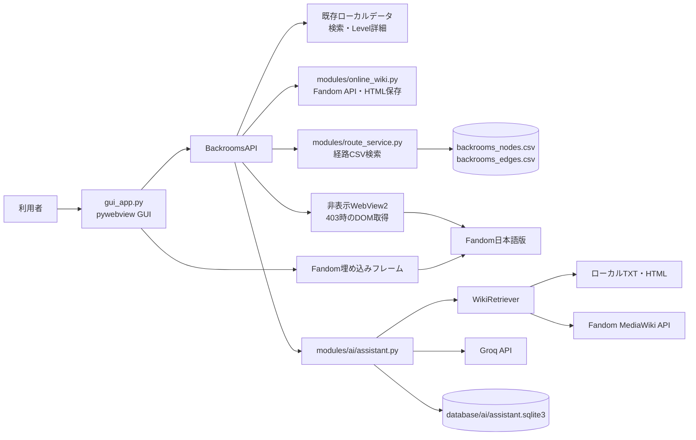
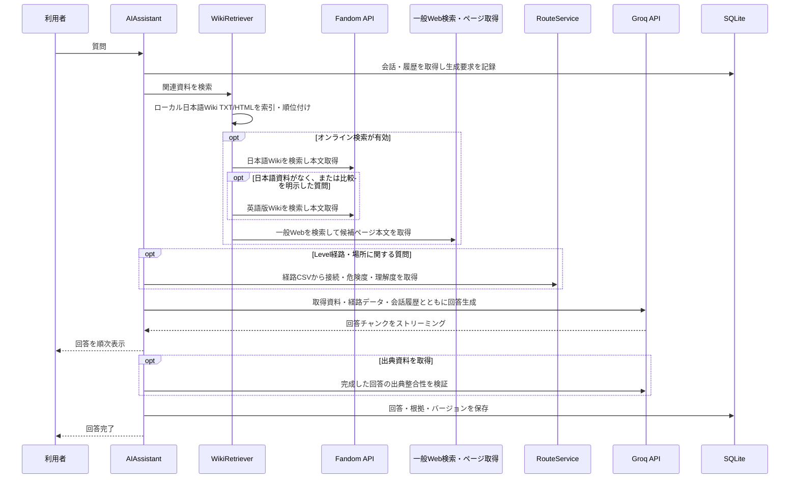
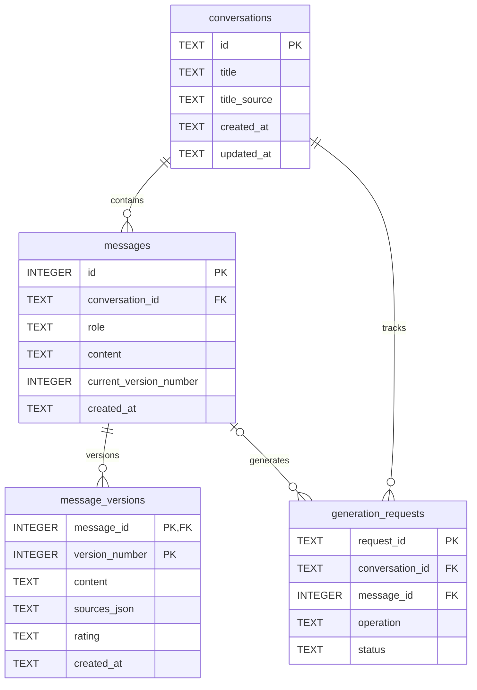

# アーキテクチャと開発ガイド

この文書はBrNavi Fandom JPの内部構成、データフロー、永続化方式、および開発時の方針を説明します。利用者向けの機能・導入手順は[README.md](../README.md)を参照してください。

## システム構成

### コンポーネント

| ファイル / モジュール | 責務 |
| --- | --- |
| `gui_app.py` | GUIのHTML/CSS/JavaScript、pywebview APIブリッジ、Level検索、経路フロー、レベルリストHTML取得、保守タスクの起動 |
| `modules/runtime_paths.py` | ソース実行時と凍結実行ファイル実行時のアプリケーションデータルート解決 |
| `modules/version.py` | GUI/CLI/ビルド処理で共用する `VERSION` 定数 |
| `modules/online_wiki.py` | Fandom MediaWiki API検索、ページ本文取得、URL検証、画像付きHTML保存 |
| `modules/ai/assistant.py` | AIチャットのオーケストレーション、検索資料の組み立て、回答検証、タイトル生成 |
| `modules/ai/wiki_retriever.py` | ローカルWiki資料の索引・順位付け、日本語・英語Backrooms Wikiおよび一般Webのオンライン検索と本文取得 |
| `modules/route_service.py` | 経路CSVの読み込み、非対話の候補解決・最短経路検索、AI向け経路コンテキスト |
| `modules/app_settings.py` | 一般設定の保存、暦上1か月単位の一覧データ自動更新スケジュール |
| `modules/ai/groq_client.py` | Groq Chat Completionsとストリーミング通信 |
| `modules/ai/markdown_renderer.py` | Markdown変換、Pygmentsコードハイライト、HTMLサニタイズ |
| `modules/ai/conversation.py` | SQLiteスキーマ、会話・メッセージ・回答バージョンの永続化 |
| `modules/database.py` | 既存Master Database、LevelデータやローカルHTMLへのアクセス |
| `modules/downloader.py` | Master DBベースのHTMLダウンロードとURLダウンロード。保存は同一ディレクトリの一時ファイルから置換 |
| `modules/extractor.py` | 保存済みHTMLから本文・タグなどを抽出 |
| `modules/network.py` / `modules/navigator.py` | 保存HTMLから接続CSVを生成し、経路を検索 |
| `modules/operation_context.py` / `modules/operations.py` | GUI・CLIから利用する保守操作の実行文脈、ログ・進捗・協調キャンセル、サービス入口 |
| `BackroomsNavigationSystem_FandomJP.py` | 従来のコンソール版エントリーポイント |

### GUIとデータ経路



経路タブ、CLI、AIは `modules/route_service.py` のCSV読込・候補解決を共有します。GUIは曖昧なLevel名に候補を返し、利用者が選択して再検索します。経路は有向グラフ上の最短経路を最大8件、最大深度30で返します。GUIは一覧から個別の縦型タイムラインへ進み、移動条件を大きく表示します。各Levelを図鑑で開き、本文が未保存なら内蔵Wikiへ案内します。環境設定からの接続CSV生成は `downloaded_fandom_html/` 内のLevel記事HTMLを直接解析し、従来と同じ列構成の `backrooms_nodes.csv` と `backrooms_edges.csv` を出力します。危険度・理解度はHTML本文から抽出し、不足する値を `extracted_fandom_levels_summary.csv` からLevelコードまたはメタタイトルで補完します。危険度の数値、可変、条件付き、N/Aと補足文を保持し、図鑑・経路詳細で同じ色区分を使います。LevelタイトルをHTMLページ情報から解決するため、記事本文を一つのTXTへ統合する処理に依存しません。解析できるLevelまたは接続が0件の場合は失敗として既存CSVを維持します。

AIは経路・出口・移動などの相談で、Levelが一つ指定された場合は登録された直接接続先、二つ指定された場合は両者間の最短経路候補をコンテキストに追加します。質問文に接続CSVの条件文が含まれる場合は、その条件と一致する経路レコードも優先して渡します。これらはローカルCSV出典として回答に付記します。情報が未登録なら未登録として扱います。グラフの欠落やWiki設定のフィクション性があるため、現実の安全や到達を保証するものではありません。

AIの検索はローカルWiki資料を順位付けし、日本語・英語Backrooms Wikiや一般Webの本文を取得します。Fandom記事はMediaWiki APIの検索・ページ本文APIで取得し、一般Web結果にFandom記事URLが含まれた場合もAPI経由へ切り替えます。Fandom検索にはChrome互換のHTTP指紋とUser-Agentを設定します。ローカル日本語本文が見つかった通常検索でもFandom APIを補助検索し、一般Web資料もあわせて探します。検索結果のタイトルだけは回答の出典に使いません。

危険度・安全・理解度・カテゴリ・ηなどの条件検索意図がある場合、`extracted_fandom_levels_summary.csv`、`parsed_index/pages_database_classified.csv`、`parsed_index/pages_master.csv` を読み、Level名・カテゴリ・危険度・理解度・タグと、対応するローカル記事本文の冒頭を組み合わせたメタデータ候補を作ります。条件に合うものを最大15件まで出典資料として渡し、指定された危険度の数値やηカテゴリが分かる場合は絞り込みます。

出典資料が0件の場合はGroqを呼ばず、「該当する資料が見つかりませんでした。具体的なLevel番号（例：Level 16 η）を指定して質問するか、『HTML取得・データ抽出』タブから対象ページのオフライン保存を行ってください。」だけを返します。画面には追加で日本語版Wiki候補を検索する操作を表示します。記事の保存は候補選択後に記事名・URL・本文と画像を明示した利用者確認を通過した場合だけ実行し、API本文を `downloaded_fandom_html/` へ保存してから同じ質問を再実行します。オンライン検索・本文取得エラーはAIの状態表示に残します。

質問文に明示されたLevelについてローカル本文が未保存なら、ほかの出典で回答できる場合にも対象ページの取得操作を表示します。片方向だけに入口・出口が記載される可能性を案内し、利用者が保存を承諾したときだけ記事と画像を保存して接続CSVを再解析します。再解析が成功した場合、同じ質問を再実行して最新経路データを読み直します。

出典URLおよび回答内URLはMarkdownリンクとして描画し、クリックをアプリ内Wikiタブのブラウザーへ振り向けます。HTTP(S)以外、認証情報付きURL、ループバック・プライベートIP、ローカルホスト名は拒否します。出典のある主張は別のGroq呼び出しで照合し、回答に資料区分・URL・取得時刻またはローカル更新時刻・抜粋を付けます。

GUIの環境設定は `database/app_settings.json` に保存します。自動更新は初回起動時に実行し、その後は暦上1か月ごとにアプリ実行中も期限を定期確認して一覧HTMLを再取得します。期限中にアプリが終了していた場合は次回起動時に実行します。更新はバックグラウンドで行い、手動実行で成功した場合も次回予定を更新します。キャンセルや失敗の状態と試行日時も保存するため、次の自動試行まで同じ失敗を毎起動ごとに繰り返しません。停止中のままプロセスが終了したケースは30分後以降に再試行します。

Windowsでは `webview.start(gui="edgechromium")` を使い、WebView2をレンダラーとして起動します。GUIの主画面は `gui_app.py` 内の `HTML_TEMPLATE` から生成され、JavaScriptは `BackroomsAPI` のメソッドを `pywebview.api` 経由で呼び出します。

### 実行時データパス

`modules/runtime_paths.py` の `get_application_dir()` は、ソース実行ではリポジトリルート、PyInstaller実行ではexeの配置フォルダーをアプリケーションデータルートとして返します。アプリから読み書きする相対データはこのルートを基準にし、現在の作業ディレクトリに依存させません。

配布ビルドはGUIとCLIそれぞれのonedirフォルダーに、実行時に必要となるデータ保存先だけを空で作成します。Wiki記事本文・画像・抽出済み本文・索引・生成CSV・会話DB・APIキーなど、ビルド元にある利用者データは配布物へコピーしません。利用者は必要な記事をアプリ内の機能からオンデマンドで取得します。必要な階層だけをローカルに蓄積することで配布容量を抑え、MIT Licenseのソースコードと、外部Wikiコンテンツに適用されるライセンスの境界を分離します。アプリケーションフォルダーには書き込み権限が必要です。書き込み不可のProgram Files等へのインストールは現在サポートしていません。

日本語版 Backrooms Wiki の文章は、個別の表示がない限り原則 CC BY-SA 3.0 です。画像・ページごとに別条件や第三者コンテンツが含まれる可能性があるため、保存・再利用時は元ページと個別ファイルの権利表示を確認し、再配布では適用ライセンスに従って著作者・元URL・ライセンスを示します。Wiki取得処理にはリクエスト間隔を設け、短時間の過度な一括取得を避けます。本アプリは個人開発の非公式ツールであり、Fandom, Inc.またはWiki運営とは関係ありません。Groq等の外部APIキーは利用者のローカル環境変数から読み込み、ソース・配布物・Git管理対象には含めません。

## Wiki閲覧・保存

1. Wikiタブの検索はFandomのMediaWiki API (`/ja/api.php`) を呼び出し、ページ名・URL・カテゴリを取得します。検索結果は最大30件です。ブラウザーに近いUser-Agent、Accept、Accept-Language、Refererを設定します。
2. 選択した検索結果または入力されたURLは、日本語版WikiのHTTPS記事URLであることをPython側でも検証します。
3. 記事はWebView内のiframeへ読み込みます。WebViewのFandom HTML応答URLを監視して現在の記事URLを画面へ返し、「表示中を保存」の対象にします。
4. 保存処理はMediaWiki APIから取得した記事本文を管理メタデータ付きHTMLにし、一時ファイルから `os.replace()` で `downloaded_fandom_html/` に保存します。APIがHTTP 403を返した場合は非表示のEdge WebView2ウィンドウで同一の公開記事を開き、DOM本文を取得して保存します。記事HTMLへの直接HTTPリクエストは行いません。
5. HTML内の許可されたFandom画像ホストを調べて画像を取得し、記事名に対応する `_assets` フォルダーへ相対パスで保存します。1ページあたり最大40画像、1画像あたり20 MiBまでです。

閲覧ではFandom本来のページ表示を保ち、保存では既存ダウンローダーとの互換性を保つ設計です。通常の保存では画面に描画されたiframeのDOMを使わず、APIが403を返した場合に限って独立したWebView2セッションのDOMを取得します。Fandomのページ構造・アクセス制御・画像ホストの変更により表示や保存が影響を受けることがあります。

## レベルリストHTML取得・データ抽出

- GUIの「HTML取得・データ抽出」タブは `level_lists/*.txt` を読み込みます。各ファイルのカテゴリ見出し、番号付きタイトル、URL、および `SOURCE` / `INDEX` / `TRANSLATION_SECTION` を解析し、利用可能な言語を選べるようにします。`_summary.txt` は言語リストから除外します。
- タイトル・カテゴリ・言語を含むエクスプローラー風の行一覧を表示し、単一選択、アンカーからのShift範囲選択、個別解除を画面内で管理します。右クリックはブラウザーのコンテキストメニューを抑止し、選択中の該当行だけを解除します。言語切り替え時は選択とアンカーをリセットします。検索結果とWiki閲覧・保存の動作は共有しません。
- GUI APIは選択データを再検証し、HTTPSかつ `backrooms.fandom.com` のWiki記事URLだけを保守サービスへ渡します。「Level情報のオフライン保存」は既存の `download_page()` を使ってHTMLを取得し、その戻り値のファイル一覧だけをTXT抽出と画像抽出の両方へ渡します。既存HTMLは上書き指定がなければ再利用します。
- `download_url()` は取得したHTMLを同一ディレクトリの一時ファイルに書き、キャンセル確認後に `os.replace()` で切り替えます。キャンセルや書き込み失敗時に既存ファイルを途中まで上書きしないための処理です。キャンセルはページ間と保存前に確認し、進行中のHTTP要求は強制終了せずタイムアウト後に処理を止めます。
- 選択HTMLのTXT抽出では `extract_levels(html_files=..., merge_existing=True)` を使います。選択外の既存TXTとSummary CSV行を維持し、対象HTMLの結果だけを追加・更新した後、統合TXTを再生成します。全HTMLを対象にする `extract_info` はCLI互換の操作として残り、GUIの環境設定タブからは実行しません。
- 画像抽出は `download_images(html_files=...)` に同じファイル一覧を渡し、選択外HTMLは走査しません。停止はファイル・画像リクエスト間で確認し、実行中のHTTP要求は最大15秒程度待ってから停止します。

## 保守操作と共有サービス層

- GUIの環境設定とレベルリスト一括保存は専用のバックグラウンドスレッドから `run_maintenance_operation()` を呼び出し、CLIの対話型メニューを経由せず同じ処理モジュールを再利用します。既存CLIのエントリーポイントと引数なしの操作関数呼び出しは維持します。
- `OperationContext` はキャンセルイベント、ログコールバック、進捗コールバックを保持します。操作は安全な処理境界でキャンセルを確認し、GUIの停止ボタンはスレッドを強制終了せず協調的に停止します。
- Master Database更新はモード（一覧HTMLを再取得する全更新／既存HTMLからの再構築）を明示して非対話実行します。既存の更新ステップ内部には未対応の長時間処理があるため、停止要求は現在のステップ完了後に反映されます。
- 情報抽出は一時ディレクトリにTXT・CSVを作成してから出力を切り替えます。ネットワーク更新も2つのCSVを一時ファイルとして生成し、出力切り替え時に既存ファイルを退避します。キャンセル時には出力を更新しません。
- GUIの環境設定パネルはログをテキストとして表示し、最大300行を保持します。処理の実行中もWebViewのUIスレッドをブロックしません。

## AI Assistant

### 検索と回答の流れ



- ローカル資料は `extracted_fandom_levels/` のTXTと `downloaded_fandom_html/` のHTMLから索引され、ファイル名、本文、Master Databaseのメタデータを使って順位付けされます。ローカル索引の対象は各形式最大5,000ファイルです。
- 条件検索では抽出済みCSVのメタデータを参照します。条件に一致する出典本文とメタデータ、対応するローカル本文冒頭を最大15件まで回答資料として渡します。
- 検索候補のタイトルやスニペットだけでは回答根拠にせず、ページ本文を取得できた資料を回答に渡します。有効な出典が0件の場合はGroqを呼び出さず、資料案内だけを返します。追加のWiki候補検索は利用者の操作で開始し、ローカル保存の直前に確認ダイアログで承諾を得ます。
- 出典IDを付けた主張は別のGroq呼び出しで資料と照合します。回答には資料の区分、クリック可能なURL、取得時刻またはローカル更新時刻、抜粋を付けます。オンライン検索や本文取得の失敗はAI欄の状態表示に残します。
- ストリーミングはGroq SDKの非同期ストリームを使います。停止操作は生成タスクをキャンセルし、完了・保存時にもキャンセル状態を確認します。再生成は完成した場合のみ新バージョンを保存するため、失敗・キャンセル時に既存回答は置き換わりません。

### 主要設定

| 設定 | 既定値 | 範囲 / 備考 |
| --- | --- | --- |
| Provider | Groq | `GROQ_API_KEY` が必要 |
| Model | `openai/gpt-oss-120b` | LLMプロパティから変更可能 |
| 最大出力トークン | 4,096 | 256～16,384 |
| 会話履歴 | 16メッセージ | 2～40 |
| コンテキスト文字数予算 | 26,000文字 | 内部既定値 |
| ローカル索引 | TXT/HTML各最大5,000件 | 資料量により検索時間が変わります |

出力上限で回答が終わった場合は続きを要求し、利用可能なコンテキストを超える場合は履歴や資料量を削減して再試行します。APIのモデル上限・レート制限・通信状態により、回答が失敗または短くなる場合があります。

## 会話データベース

SQLiteファイルは `database/ai/assistant.sqlite3` です。主なテーブルと関係は次のとおりです。



- 回答バージョンの番号はメッセージごとに採番し、`message_versions` の複合主キー `(message_id, version_number)` が一意性を保証します。`messages.current_version_number` が表示中の版を指します。
- Good / Bad評価と出典スナップショットは回答バージョン単位で保存します。旧回答の評価や出典は再生成後も各バージョンに残ります。
- `generation_requests` は送信・再生成の状態（実行中、停止要求、完了、失敗、停止）を記録します。部分インデックスにより、1会話につき同時に1件の生成要求だけを実行できます。
- 会話の `title_source` は自動生成・手動設定・旧データを区別します。自動タイトル更新は `title_source='auto'` の会話に限ります。
- 外部キーは各SQLite接続で `PRAGMA foreign_keys = ON` を設定・確認します。会話削除では外部キーの `ON DELETE CASCADE` によりメッセージ、回答バージョン、生成要求を連鎖削除します。
- 現行スキーマ番号は `PRAGMA user_version = 1` です。既存DBを更新する場合は、SQLite Backup APIでタイムスタンプ付きバックアップを作成し、バックアップの `integrity_check` 後にトランザクション内で移行します。既存会話の回答は第1版として登録します。
- SQLite接続でWALモードは明示的に設定していません。SQLiteの既定ジャーナル設定を使用します。

## データフォルダー

| パス | 用途 |
| --- | --- |
| `parsed_index/` | Master Database等のインデックス。図鑑のメタデータ、旧ダウンロード、AI資料情報に利用 |
| `downloaded_fandom_html/` | 保存したWiki HTMLと画像アセット。AI検索もローカルHTMLを参照 |
| `extracted_fandom_levels/` | HTMLから抽出したLevel本文TXT。図鑑・AI検索に利用 |
| `downloaded_images/` | Level図鑑用画像 |
| `database/ai/` | SQLite会話DB、マイグレーションバックアップ、AI設定JSON |
| `level_lists/` | コンソール版の生成データ。GUIの言語別HTML取得タブも参照 |
| `index_html/` | コンソール版の既存データ／配布用ビルドで扱うデータ |
| `downloaded_fandom_html/` | 保存したWiki HTMLと画像アセット。AI検索と接続CSV生成も参照 |
| `extracted_fandom_levels_all.txt` | CLI互換の既存処理向け統合Wiki本文。GUIの接続CSV生成は記事HTMLを直接解析 |
| `backrooms_nodes.csv`, `backrooms_edges.csv` | 経路・フロー画面とAIの場所相談が使うノード・有向エッジ。列形式は固定 |
| `extracted_fandom_levels_summary.csv`, `wiki_list.txt` | 経路ノードの危険度・理解度・表示名を補完するローカルメタデータ |
| `database/app_settings.json` | 自動一覧更新の有効状態、最終試行・成功日時、結果状態 |

Wikiのオンライン閲覧・保存以外の機能は、対応するローカルデータが必要です。データは常にリポジトリや配布物へ同梱されるとは限りません。

## 開発方針

- 既存のGUI操作・検索・Wiki閲覧・保存・保守機能を維持し、変更範囲に応じたテストを追加します。
- FandomまたはGroqの通信は既存の接続方式を再利用し、ネットワーク失敗を成功扱いにしません。AIの事実回答では取得本文と出典の対応を優先します。
- SQLiteは既存データを保持する前提とし、スキーマ変更ではバックアップと移行テストを用意します。会話や利用者のAPIキーなどのローカルデータをソース管理・配布物へ混入させません。
- GUIとCLIの両方を考慮し、データパスは現在の作業ディレクトリではなくアプリケーションルートを基準に解決します。
- バージョン番号は `modules/version.py` を正本とし、タグ付けするリリース版の前に更新します。GUIの表示・ウィンドウタイトルとCLI起動時表示は同じ値を参照します。
- GUIのアプリ情報ダイアログはモデルをローカル設定から取得し、APIキーや認証情報は返しません。外部リンクは許可済みのリポジトリ・リリース・ライセンス先に限定して既定ブラウザーで開きます。
- `build_release.bat` もPythonから `VERSION` を読み取り、配布フォルダーの `VERSION.txt` に記録します。アプリケーション本体のMIT Licenseと依存パッケージのライセンス一覧は別ファイルで配布します。
- 利用者向けの起動・操作仕様に変更があればルートのREADMEを更新し、内部構成・設計・開発手順の変更があれば本書も更新します。

## 開発とテスト

依存パッケージはルートの `requirements.txt` に記載しています。Windowsで開発環境を準備し、全テストを実行する例：

```powershell
python -m venv .venv
.\.venv\Scripts\Activate.ps1
python -m pip install -r requirements.txt
python -m unittest discover -s tests -v
```

主なテスト対象：

- `tests/test_gui_html_download.py`, `tests/test_maintenance_operations.py`：GUI APIブリッジ、保守操作の実行・キャンセル、キャンセル時の既存出力保持
- `tests/test_online_wiki.py`：Fandom検索・本文サニタイズ・画像ローカル保存
- `tests/test_ai_wiki_retriever.py`：ローカル資料検索、出典優先順位、オンラインフォールバック
- `tests/test_ai_conversation.py`：SQLiteスキーマ、会話・回答バージョン、評価、削除、マイグレーション
- `tests/test_ai_groq_client.py`, `tests/test_ai_assistant.py`, `tests/test_ai_markdown_renderer.py`, `tests/test_ai_gui_bridge.py`：Groq通信、回答生成、Markdown表示、GUI連携
- `tests/test_runtime_paths.py`：ソース実行と凍結実行ファイルのアプリケーションルート

配布ビルドはWindows上で `build_release.bat` を実行します。GUI・CLIをそれぞれPyInstallerのonedir形式でビルドします。生成物を起動確認する際は、CLIメニューの正常終了とGUIウィンドウの起動を確認します。GUIの実行には配布先のWebView2 Runtimeが必要です。
