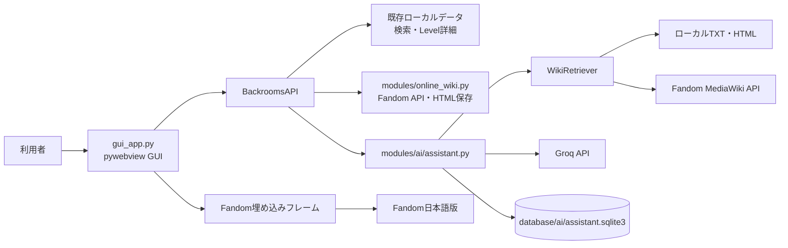
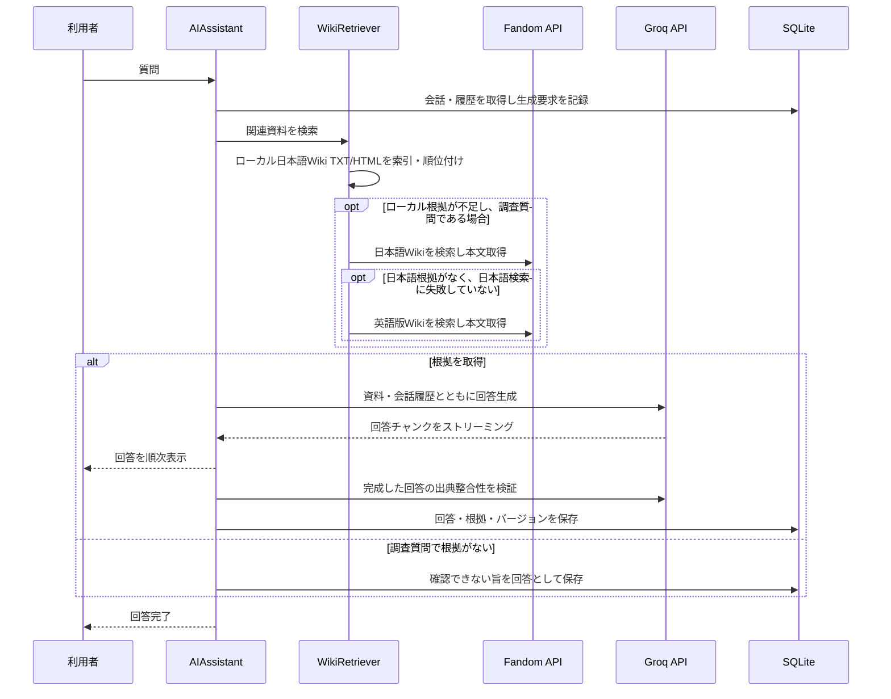
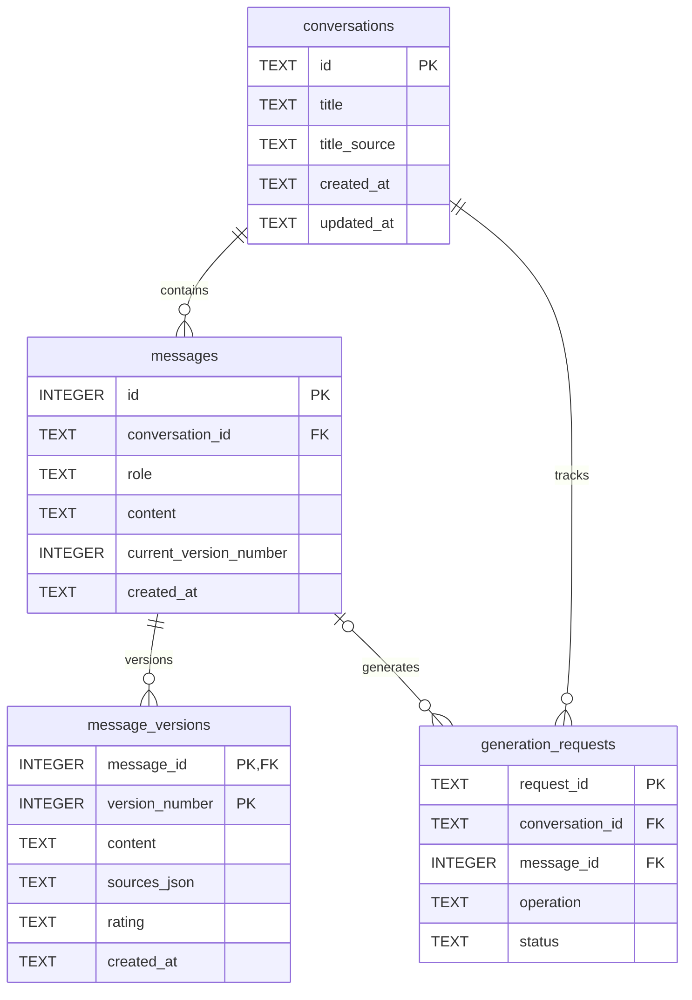

# アーキテクチャと開発ガイド

この文書はBrNavi Fandom JPの内部構成、データフロー、永続化方式、および開発時の方針を説明します。利用者向けの機能・導入手順は[README.md](../README.md)を参照してください。

## システム構成

### コンポーネント

| ファイル / モジュール | 責務 |
| --- | --- |
| `gui_app.py` | GUIのHTML/CSS/JavaScript、pywebview APIブリッジ、Level検索、レベルリストHTML取得、保守タスクの起動 |
| `modules/runtime_paths.py` | ソース実行時と凍結実行ファイル実行時のアプリケーションデータルート解決 |
| `modules/version.py` | GUI/CLI/ビルド処理で共用する `VERSION` 定数 |
| `modules/online_wiki.py` | Fandom MediaWiki API検索、ページ本文取得、URL検証、画像付きHTML保存 |
| `modules/ai/assistant.py` | AIチャットのオーケストレーション、検索資料の組み立て、回答検証、タイトル生成 |
| `modules/ai/wiki_retriever.py` | ローカルWiki資料の索引・順位付け、日本語版優先のオンライン検索 |
| `modules/ai/groq_client.py` | Groq Chat Completionsとストリーミング通信 |
| `modules/ai/markdown_renderer.py` | Markdown変換、Pygmentsコードハイライト、HTMLサニタイズ |
| `modules/ai/conversation.py` | SQLiteスキーマ、会話・メッセージ・回答バージョンの永続化 |
| `modules/database.py` | 既存Master Database、LevelデータやローカルHTMLへのアクセス |
| `modules/downloader.py` | Master DBベースのHTMLダウンロードとURLダウンロード。保存は同一ディレクトリの一時ファイルから置換 |
| `modules/extractor.py` | 保存済みHTMLから本文・タグなどを抽出 |
| `modules/network.py` / `modules/navigator.py` | 抽出データから接続ネットワークを生成し、経路を検索 |
| `modules/operation_context.py` / `modules/operations.py` | GUI・CLIから利用する保守操作の実行文脈、ログ・進捗・協調キャンセル、サービス入口 |
| `BackroomsNavigationSystem_FandomJP.py` | 従来のコンソール版エントリーポイント |

### GUIとデータ経路



Windowsでは `webview.start(gui="edgechromium")` を使い、WebView2をレンダラーとして起動します。GUIの主画面は `gui_app.py` 内の `HTML_TEMPLATE` から生成され、JavaScriptは `BackroomsAPI` のメソッドを `pywebview.api` 経由で呼び出します。

### 実行時データパス

`modules/runtime_paths.py` の `get_application_dir()` は、ソース実行ではリポジトリルート、PyInstaller実行ではexeの配置フォルダーをアプリケーションデータルートとして返します。アプリから読み書きする相対データはこのルートを基準にし、現在の作業ディレクトリに依存させません。

配布ビルドはGUIとCLIそれぞれのonedirフォルダーにローカルWikiデータをコピーします。会話DB、APIキー、その他の利用者固有データはビルド元からコピーせず、配布先の `database/ai/` に作成します。アプリケーションフォルダーには書き込み権限が必要です。書き込み不可のProgram Files等へのインストールは現在サポートしていません。

## Wiki閲覧・保存

1. Wikiタブの検索はFandomのMediaWiki API (`/ja/api.php`) を呼び出し、ページ名・URL・カテゴリを取得します。検索結果は最大30件です。
2. 選択した検索結果または入力されたURLは、日本語版WikiのHTTPS記事URLであることをPython側でも検証します。
3. 記事はWebView内のiframeへ読み込みます。WebViewのFandom HTML応答URLを監視して現在の記事URLを画面へ返し、「表示中を保存」の対象にします。
4. 保存処理は既存の `modules.downloader.download_url` を再利用してHTMLを取得し、`downloaded_fandom_html/` に保存します。
5. HTML内の許可されたFandom画像ホストを調べて画像を取得し、記事名に対応する `_assets` フォルダーへ相対パスで保存します。1ページあたり最大40画像、1画像あたり20 MiBまでです。

閲覧ではFandom本来のページ表示を保ち、保存では既存ダウンローダーとの互換性を保つ設計です。画面に描画されたiframeのDOMそのものは保存しません。Fandomのページ構造・レスポンスヘッダー・画像ホストの変更により表示や保存が影響を受けることがあります。

## レベルリストHTML取得・データ抽出

- GUIの「HTML取得・データ抽出」タブは `level_lists/*.txt` を読み込みます。各ファイルのカテゴリ見出し、番号付きタイトル、URL、および `SOURCE` / `INDEX` / `TRANSLATION_SECTION` を解析し、利用可能な言語を選べるようにします。`_summary.txt` は言語リストから除外します。
- タイトル・カテゴリ・言語を含むエクスプローラー風の行一覧を表示し、単一選択、アンカーからのShift範囲選択、個別解除を画面内で管理します。右クリックはブラウザーのコンテキストメニューを抑止し、選択中の該当行だけを解除します。言語切り替え時は選択とアンカーをリセットします。検索結果とWiki閲覧・保存の動作は共有しません。
- GUI APIは選択データを再検証し、HTTPSかつ `backrooms.fandom.com` のWiki記事URLだけを保守サービスへ渡します。「Level情報のオフライン保存」は既存の `download_page()` を使ってHTMLを取得し、その戻り値のファイル一覧だけをTXT抽出と画像抽出の両方へ渡します。既存HTMLは上書き指定がなければ再利用します。
- `download_url()` は取得したHTMLを同一ディレクトリの一時ファイルに書き、キャンセル確認後に `os.replace()` で切り替えます。キャンセルや書き込み失敗時に既存ファイルを途中まで上書きしないための処理です。キャンセルはページ間と保存前に確認し、進行中のHTTP要求は強制終了せずタイムアウト後に処理を止めます。
- 選択HTMLのTXT抽出では `extract_levels(html_files=..., merge_existing=True)` を使います。選択外の既存TXTとSummary CSV行を維持し、対象HTMLの結果だけを追加・更新した後、統合TXTを再生成します。従来の保守タブの `extract_info` は全HTMLを対象とする既存動作を維持します。
- 画像抽出は `download_images(html_files=...)` に同じファイル一覧を渡し、選択外HTMLは走査しません。停止はファイル・画像リクエスト間で確認し、実行中のHTTP要求は最大15秒程度待ってから停止します。

## 保守操作と共有サービス層

- GUIは専用のバックグラウンドスレッドから `run_maintenance_operation()` を呼び出し、CLIの対話型メニューを経由せず同じ処理モジュールを再利用します。既存CLIのエントリーポイントと引数なしの操作関数呼び出しは維持します。
- `OperationContext` はキャンセルイベント、ログコールバック、進捗コールバックを保持します。操作は安全な処理境界でキャンセルを確認し、GUIの停止ボタンはスレッドを強制終了せず協調的に停止します。
- Master Database更新はモード（一覧HTMLを再取得する全更新／既存HTMLからの再構築）を明示して非対話実行します。既存の更新ステップ内部には未対応の長時間処理があるため、停止要求は現在のステップ完了後に反映されます。
- 情報抽出は一時ディレクトリにTXT・CSVを作成してから出力を切り替えます。ネットワーク更新も2つのCSVを一時ファイルとして生成し、出力切り替え時に既存ファイルを退避します。キャンセル時には出力を更新しません。
- GUIの保守パネルはログをテキストとして表示し、最大300行を保持します。処理の実行中もWebViewのUIスレッドをブロックしません。

## AI Assistant

### 検索と回答の流れ



- ローカル資料は `extracted_fandom_levels/` のTXTと `downloaded_fandom_html/` のHTMLから索引され、ファイル名、本文、Master Databaseのメタデータを使って順位付けされます。ローカル索引の対象は各形式最大5,000ファイルです。
- 通常は日本語Wikiの資料を優先します。日本語の根拠が見つからない調査質問では日本語版をオンライン検索して本文を取得し、それでも該当本文を確認できない場合に英語版を探索します。比較を明示した質問は外部資料も検索対象にします。
- 検索候補のタイトルやスニペットだけでは回答根拠にせず、ページ本文を取得できた資料を回答に渡します。資料がない調査質問には、情報を補完せず未確認である旨を返します。
- 根拠がある回答は別のGroq呼び出しで出典との整合性を検証し、回答に出典名・URL・取得時刻またはローカル更新時刻・抜粋を付けます。オンライン検索や本文取得の失敗も注意として示します。
- ストリーミングはGroq SDKの非同期ストリームを使います。停止操作は生成タスクをキャンセルし、完了・保存時にもキャンセル状態を確認します。再生成は完成した場合のみ新バージョンを保存するため、失敗・キャンセル時に既存回答は置き換わりません。

### 主要設定

| 設定 | 既定値 | 範囲 / 備考 |
| --- | --- | --- |
| Provider | Groq | `GROQ_API_KEY` が必要 |
| Model | `openai/gpt-oss-120b` | LLMプロパティから変更可能 |
| 最大出力トークン | 4,096 | 256～16,384 |
| 会話履歴 | 16メッセージ | 2～40 |
| コンテキスト文字数予算 | 26,000文字 | 内部既定値 |
| ローカル索引 | TXT/HTML各最大5,000件 | 資料量により検索時間が変わります |

出力上限で回答が終わった場合は続きを要求し、利用可能なコンテキストを超える場合は履歴や資料量を削減して再試行します。APIのモデル上限・レート制限・通信状態により、回答が失敗または短くなる場合があります。

## 会話データベース

SQLiteファイルは `database/ai/assistant.sqlite3` です。主なテーブルと関係は次のとおりです。



- 回答バージョンの番号はメッセージごとに採番し、`message_versions` の複合主キー `(message_id, version_number)` が一意性を保証します。`messages.current_version_number` が表示中の版を指します。
- Good / Bad評価と出典スナップショットは回答バージョン単位で保存します。旧回答の評価や出典は再生成後も各バージョンに残ります。
- `generation_requests` は送信・再生成の状態（実行中、停止要求、完了、失敗、停止）を記録します。部分インデックスにより、1会話につき同時に1件の生成要求だけを実行できます。
- 会話の `title_source` は自動生成・手動設定・旧データを区別します。自動タイトル更新は `title_source='auto'` の会話に限ります。
- 外部キーは各SQLite接続で `PRAGMA foreign_keys = ON` を設定・確認します。会話削除では外部キーの `ON DELETE CASCADE` によりメッセージ、回答バージョン、生成要求を連鎖削除します。
- 現行スキーマ番号は `PRAGMA user_version = 1` です。既存DBを更新する場合は、SQLite Backup APIでタイムスタンプ付きバックアップを作成し、バックアップの `integrity_check` 後にトランザクション内で移行します。既存会話の回答は第1版として登録します。
- SQLite接続でWALモードは明示的に設定していません。SQLiteの既定ジャーナル設定を使用します。

## データフォルダー

| パス | 用途 |
| --- | --- |
| `parsed_index/` | Master Database等のインデックス。図鑑のメタデータ、旧ダウンロード、AI資料情報に利用 |
| `downloaded_fandom_html/` | 保存したWiki HTMLと画像アセット。AI検索もローカルHTMLを参照 |
| `extracted_fandom_levels/` | HTMLから抽出したLevel本文TXT。図鑑・AI検索に利用 |
| `downloaded_images/` | Level図鑑用画像 |
| `database/ai/` | SQLite会話DB、マイグレーションバックアップ、AI設定JSON |
| `level_lists/` | コンソール版の生成データ。GUIの言語別HTML取得タブも参照 |
| `index_html/` | コンソール版の既存データ／配布用ビルドで扱うデータ |

Wikiのオンライン閲覧・保存以外の機能は、対応するローカルデータが必要です。データは常にリポジトリや配布物へ同梱されるとは限りません。

## 開発方針

- 既存のGUI操作・検索・Wiki閲覧・保存・保守機能を維持し、変更範囲に応じたテストを追加します。
- FandomまたはGroqの通信は既存の接続方式を再利用し、ネットワーク失敗を成功扱いにしません。AIの事実回答では取得本文と出典の対応を優先します。
- SQLiteは既存データを保持する前提とし、スキーマ変更ではバックアップと移行テストを用意します。会話や利用者のAPIキーなどのローカルデータをソース管理・配布物へ混入させません。
- GUIとCLIの両方を考慮し、データパスは現在の作業ディレクトリではなくアプリケーションルートを基準に解決します。
- バージョン番号は `modules/version.py` を正本とし、タグ付けするリリース版の前に更新します。GUIの表示・ウィンドウタイトルとCLI起動時表示は同じ値を参照します。
- GUIのアプリ情報ダイアログはモデルをローカル設定から取得し、APIキーや認証情報は返しません。外部リンクは許可済みのリポジトリ・リリース・ライセンス先に限定して既定ブラウザーで開きます。
- `build_release.bat` もPythonから `VERSION` を読み取り、配布フォルダーの `VERSION.txt` に記録します。アプリケーション本体のMIT Licenseと依存パッケージのライセンス一覧は別ファイルで配布します。
- 利用者向けの起動・操作仕様に変更があればルートのREADMEを更新し、内部構成・設計・開発手順の変更があれば本書も更新します。

## 開発とテスト

依存パッケージはルートの `requirements.txt` に記載しています。Windowsで開発環境を準備し、全テストを実行する例：

```powershell
python -m venv .venv
.\.venv\Scripts\Activate.ps1
python -m pip install -r requirements.txt
python -m unittest discover -s tests -v
```

主なテスト対象：

- `tests/test_gui_html_download.py`, `tests/test_maintenance_operations.py`：GUI APIブリッジ、保守操作の実行・キャンセル、キャンセル時の既存出力保持
- `tests/test_online_wiki.py`：Fandom検索・本文サニタイズ・画像ローカル保存
- `tests/test_ai_wiki_retriever.py`：ローカル資料検索、出典優先順位、オンラインフォールバック
- `tests/test_ai_conversation.py`：SQLiteスキーマ、会話・回答バージョン、評価、削除、マイグレーション
- `tests/test_ai_groq_client.py`, `tests/test_ai_assistant.py`, `tests/test_ai_markdown_renderer.py`, `tests/test_ai_gui_bridge.py`：Groq通信、回答生成、Markdown表示、GUI連携
- `tests/test_runtime_paths.py`：ソース実行と凍結実行ファイルのアプリケーションルート

配布ビルドはWindows上で `build_release.bat` を実行します。GUI・CLIをそれぞれPyInstallerのonedir形式でビルドします。生成物を起動確認する際は、CLIメニューの正常終了とGUIウィンドウの起動を確認します。GUIの実行には配布先のWebView2 Runtimeが必要です。
